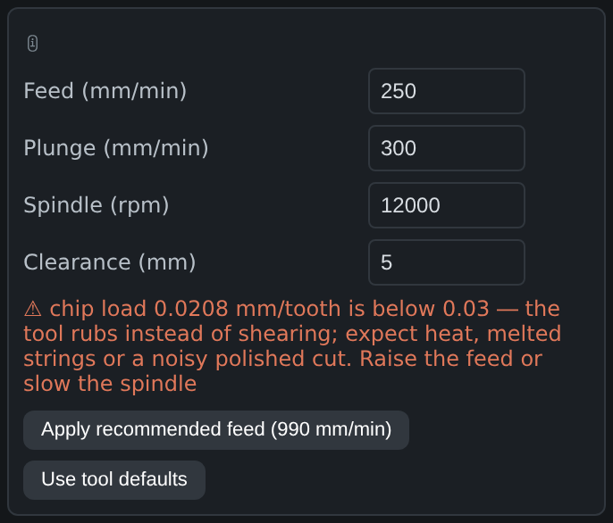

# Feeds and speeds

Every operation cuts with three numbers: how fast the tool moves, how
fast it spins, and how much material each cutting edge takes per bite.
simple.cam fills all three from presets, checks them for you, and shows
its work in the ⚡ popup on every op row.

## The three numbers

- **[Feed rate](../glossary.md#feed-rate)** (mm/min) — how fast the tool
  travels through the material.
- **[Spindle](../glossary.md#spindle) speed** (RPM) — how fast the tool
  spins.
- **[Chip load](../glossary.md#chip-load)** (mm/tooth) — how much
  material each cutting edge removes per revolution. The tool's [flutes](../glossary.md#flutes)
  count feeds in: chip load = feed ÷ (RPM × flutes).

Chip load is the number that predicts trouble. Too low and the tool
rubs instead of shearing — heat, melted strings on plastic, a noisy
polished cut. Too high and each tooth bites hard — a rough cut, a
stalling spindle, a snapped bit.

**3D-printing analogy:** RPM is your nozzle temperature — the regime
the tool cuts in. Feed is the flow rate. Chip load is what actually
lands per unit time, and both extremes hurt: too little per bite and
the tool rubs (under-extrusion, but with metal), too much and it jams.

## Where the numbers come from

The [stock material](../glossary.md#stock) picks a preset table:
Aluminum 6061, Brass 360, Delrin (acetal), Hardwood (maple/birch), or
Acrylic (cast). Each table carries a cut feed per tool type, and the
[plunge](../glossary.md#plunge) feed is a set fraction of it — about a
third on metals and acrylic, half on Delrin and hardwood. These are
starting points for a hobby-class spindle with Ø6 mm-class cutters,
not laws.

The tool adds its own layer. A tool in the library can carry
per-material preset rows, and a matching row wins over the built-in
table for feed and RPM. Per-op overrides win over both. When a fresh
op's resolved defaults fall outside the healthy chip-load band, the
op's ⚡ boxes arrive already prefilled with the healthy numbers — the
app won't quietly hand a Delrin job the metal row's RPM.

## The ⚡ popup

The ⚡ button on each op row opens the rates popup. The boxes show the
effective values — your override if you've set one, the preset if not:

- **Feed**, **Plunge**, **Spindle**, and **Clearance** — editable here;
  an edit sets a per-op override until you press **Use tool defaults**.
  On a laser tool the Spindle box becomes Power (%) — beam power, not a
  speed, so chip-load advice doesn't apply.
- A chip-load verdict line: ✓ when the current feed/RPM/flutes sit in
  the healthy band for this material and tool, ⚠ when they don't, with
  the measured value and what to change.
- A [step-down](../glossary.md#step-down) verdict, when the op carries
  one: it grades depth against the cutter diameter (metals max out
  around 0.5×Ø, plastics and woods up to 1×Ø).
- On deep bulk cuts, a note that the op runs [adaptive clearing](../glossary.md#adaptive-clearing)
  with derived step-down and feed — those rates are computed, never
  fields.

<!-- CAPTURE: an op on Delrin stock, ⚡ popup open, with a chip-load ⚠
     verdict line (low verdict — "raise the feed or slow the spindle")
     and the "Apply recommended feed" button visible; a second advice
     line (step-down or adaptive roughing) welcome. Crop to the popup -->

*Figure 1 — The verdict grades the numbers in the boxes; edit a box and the grade updates to match.*

When a chip-load line warns, don't ignore it — it's the one warning
that costs tools or parts. The direction is in the note itself: too
low means raise the feed or slow the spindle, too high means the
reverse. The **Apply recommended feed** button does the arithmetic for
you: it stamps a feed that puts chip load back inside the band and
rescales the plunge to match. You can also just edit the boxes; the
choice stays yours either way.

## Finding your material's real numbers

Presets are a starting point; your machine, your tool, and your exact
material have the last word. The **Calibration…** button in the top
bar opens the Calibration coupon dialog: it lays a grid of test cells
across your whole stock, varying two parameters (feed and RPM by
default) while everything else stays pinned to the preset. Flat stock
gets square pockets; rotary stock gets spiral grooves. Generate it and
the coupon arrives as ordinary ops — every cell is an op row with its
rates in its own ⚡ popup and its minutes in the estimate.

Run it, look at the cells, and keep the parameters of the cleanest
one. The winning cell's rates are the numbers your machine and
material actually want — start from them in future jobs.

## The rotary ceiling

In 4-axis work the [A axis](../glossary.md#a-axis) spins the stock
instead of the tool, and it tops out around 6.6 RPM — the community
firmware's sustainable limit for the rotary drive. Pure-rotary cuts
are timed through [G93](../glossary.md#g93) inverse-time feed, and the
timing floors at that A-rate: ask for more feed than the ceiling
allows and the cut stays safe but runs at the cap, slower than the
G-code label claims. The Calibration coupon warns before this
happens and suggests capping the feed axis there.

The cap also sets a hard surface-speed trade-off: 6.6 revolutions per
minute moves a Ø60 mm bar's surface about as fast as it moves a Ø15
mm bar's surface — four times slower. On thin stock, light depths and
sharp tools keep the cut clean at that speed.
