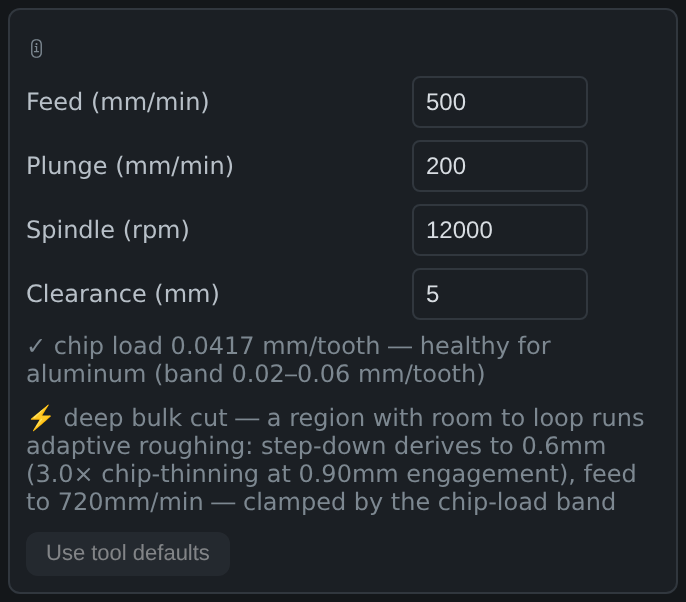

# Step over and step down

Two spacing numbers shape every multi-pass cut. [Step down](../glossary.md#step-down)
sets how deep each level goes; [step over](../glossary.md#step-over) sets
how far sideways the neighboring pass sits. Between them they decide how
many [passes](../glossary.md#pass) the job cuts — and every pass costs
time and tool life.

## What they are

- **Step down** (mm) — how much deeper the tool cuts on each level
  before it stops and moves sideways. A 9 mm pocket with Step down 3
  cuts three levels of 3 mm.
- **Step over** (mm) — how far the tool shifts sideways between
  neighboring passes at the same depth. Neighboring passes overlap,
  which is what keeps no ridges of material standing between them.

**3D-printing analogy:** Step down is your layer height — the
coarsest setting that still gives the shape you want wins on time.
Step over is line spacing in a top-layer infill: wider fills faster,
closer leaves a smoother floor.

## Why they matter

Both numbers trade cut time against load and finish. Bigger values cut
fewer passes, so the job runs faster — but each pass removes more
material, and the surface between passes gets rougher.

- **Step over is the tool's bite.** At half the diameter, the cutter
  only ever takes half its width — it always has somewhere to escape.
  Widen it toward the full diameter and the tool slots: fully buried
  on both sides, chips trapped, heat and snap risk. On deep cuts this
  is the number that kills bits.
- **Step down is the axial load.** The [⚡ popup](../concepts/feeds-and-speeds.md)
  grades your value against the cutter diameter: metals top out around
  half the cutter Ø per level, plastics and woods allow a full Ø. Push
  past that and the app warns; far past it, the chips physically can't
  clear and the bit snaps.
- **Finish rides on step over.** Fine spacing leaves shallow scallops
  between passes. Coarse spacing leaves waves you'll sand off later —
  or hand to a finishing pass (see [Allowances](../concepts/allowances.md)).

Neither number is a quality dial alone. A huge step down buries the
tool even with a fine step over; the reverse just cuts slowly.

## How simple.cam defaults them

The fields are labeled **Step down (mm)** and **Step over (mm)** on
most ops with a depth ladder — [Pocket](../ops/pocket.md),
[Profile](../ops/profile.md), slice pocket, [rotary work](../ops/rotary-face.md).
Shared semantics live in [Fields every operation shares](../reference/fields.md#step-down-and-step-over).

- **Step over defaults to half the tool's diameter**, rounded to the
  nearest 0.1 mm. A Ø6 flat [end mill](../glossary.md#end-mill) starts
  at 3 mm; a Ø2 starts at 1. The default rides the tool you picked, so
  swapping tools re-scales it — a fixed guess would ignore the cutter.
- **Step down defaults to your tool's own preset row** for the stock
  material. No matching row? The material's fallback table. Either
  way it's capped at half the cutter diameter, so a small tool can
  never arrive pre-set to bury itself.

**Tip:** the defaults are the conservative end, not the optimum. Your
[Calibration coupon](../getting-started/your-first-cut.md) can tell you
what your machine and material actually tolerate.

## When a deep cut goes adaptive

On deep bulk cuts, Pocket switches its roughing to
[adaptive clearing](../glossary.md#adaptive-clearing) on its own —
there's no switch. The trigger is the cut's shape, never your material
or your settings. It fires when the cut runs deeper than two tool
diameters, over at least two roughing levels, in a region with room to
loop more than one pass.

The tool's bite then drops to about 15% of its diameter. Thin chips
buy depth and speed back: the app triples your preset step-down and
feed, then clamps the result. Step-down clamps at the tool's
[flute length](../glossary.md#flutes) and the material's depth
ceiling; feed clamps at the [chip load](../glossary.md#chip-load)
band. Your Step over field isn't consulted — the strategy spaces its
own passes.

<!-- CAPTURE: a Pocket op on a Ø6 flat end mill, Start depth 0, End
     depth 15 (past the two-diameter trigger), panel expanded, ⚡ rates
     popup open — the "⚡ deep bulk cut" hint line visible with its
     derived step-down and feed numbers. Crop to the popup -->

*Figure 1 — The derived numbers are read-only: there is no field behind them, and cuts that aren't deep never see this line.*

The same engine also runs the bulk-clearing frames other ops hand to
it: a Profile's clear-excess-stock sweep, a slice pocket's inside
clear. It never runs rotary cuts — there the A-axis speed is the
bottleneck, not chip load.

## Tips & pitfalls

- **Raising Step over past half the Ø** pushes toward slotting, and on
  the rotary ops the drive carries that load directly. The default is
  conservative for a reason.
- **A finishing pass ignores the ladder entirely.** Ticking
  *finishing pass only* hides Step down and cuts one pass at full
  depth — the roughing levels were its job (see
  [Fields every operation shares](../reference/fields.md#finishing-pass-only)).
- **The same word, narrower meanings.** Thread mill's Step over is a
  radial depth per pass (0 cuts the full form in one pass); engrave
  fill's spacing defaults to the tip's width, not the shank Ø. When an
  op's ⓘ help mentions Step over, trust its wording over the generic
  one.
- **Profile carries only Step down** — a wall pass has no neighbors to
  space, so its panel shows no Step over field.
