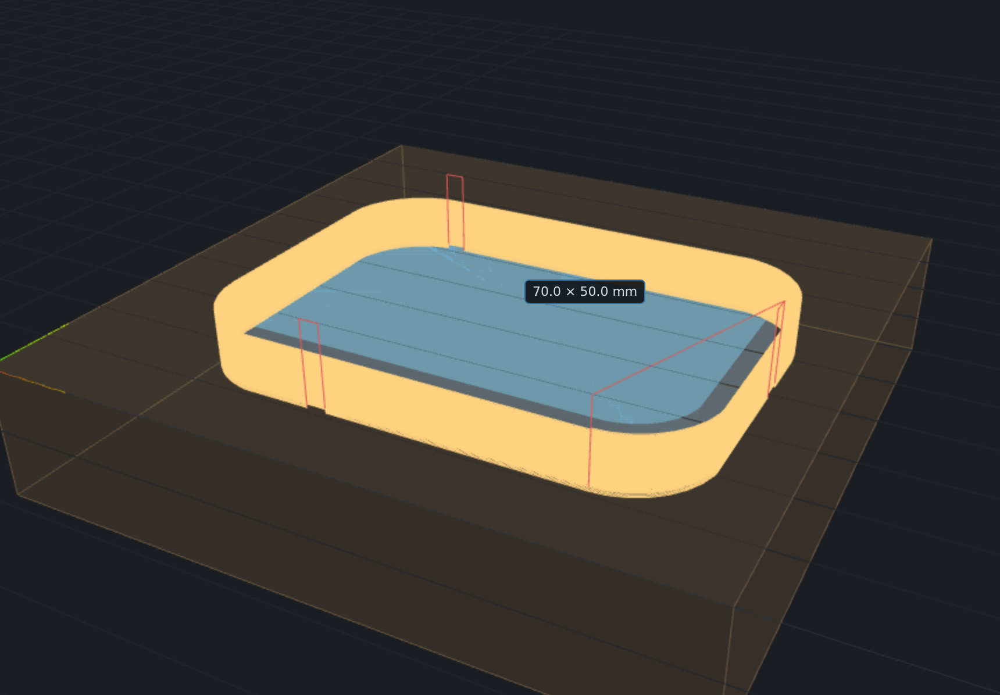

# Tabs

[Tabs](../glossary.md#tabs) are small bridges of [stock](../glossary.md#stock)
that a through cut leaves standing, so the part stays attached to the
frame until the job ends. Afterwards you snap the part free and file
the nubs flat.

## Why a through cut needs them

A cut that runs past the part's bottom severs the part on its last
level. With tabs off, the part comes loose mid-job — it can shift into
the tool, or break loose and fly. Tabs keep it put: the deep levels cut
almost the whole outline and leave a few bridges holding on.

**3D-printing analogy:** tabs work like break-away supports. The part
stays attached at a few spots; you snap it free afterwards and clean
the attachment marks off the edge.

**Caution:** on any cut that goes past the part's bottom, tick tabs.
An unticked through cut sets the part free before the job ends.

## The tab fields

You'll find them on the Profile op, and on a Slice pocket set to cut
outside. Tick **tabs — leave holding bridges across the cut** and three
boxes appear:

- **Tab count** — how many bridges. Default 3.
- **Tab height** — how tall each bridge stands. Default 0.5 mm,
  measured up from the cut floor (your End depth), not from the
  stock's [crown](../glossary.md#crown).
- **Tab length** — how much outline each bridge covers. Default 3 mm.

The field details live in [the fields reference](../reference/fields.md#tabs).

## How simple.cam places them

You set the count; the app places the bridges for you:

- **Evenly along the outline.** Spacing is measured by arc length, so
  the bridges sit at even fractions of the loop's perimeter — irregular
  shapes still get even bridges.
- **Never across the loop's starting point.** The loop's seam falls in
  the middle of a cut span, so no bridge straddles it.
- **The same spots on every level.** Placement is worked out once per
  outline, so the bridges line up vertically through the cut band —
  each bridge is one post, not a staircase.
- **Clamped with a warning.** A loop too short for even one bridge cuts
  through uncut, with a "loop too short for tabs" warning. A count too
  high for the loop is trimmed to what fits — "tab count clamped to 2
  on a 28.0mm loop".

Two more behaviors worth knowing:

- Set Tab height at or above the top of the cut band and no bridge can
  stand anywhere. The app warns ("no bridges left standing") and cuts
  as if tabs were off.
- [Step-down](../glossary.md#step-down) sets the level spacing, so it
  decides how many deep levels cut the interrupted spans below the tab
  tops.

<!-- CAPTURE: demo part is a rounded-corner plate 70 x 50 x 8 mm (corner
     radius 10 mm) on the default 100 x 100 x 20 box stock, plate top
     flush with the crown. Profile op, Side outside, Start depth 0,
     End depth 8.5, tabs ticked at the defaults (Tab count 3 /
     Tab height 0.5 / Tab length 3), Recalculate pressed — toolpath
     preview on, the amber wall ring visible at every level, gaps in
     the deep-level loops where the three tabs hold the part.
     Framing: loose crop of the viewport with the preview -->

*Figure 1 — The gaps sit only in the loops below the tab tops; the levels above them cut the full ring.*

## After the job

Let the job finish — the bridges are what keep the part still while
the last levels cut. Then free the part: break or cut each bridge, and
file the nub flush with the wall. Tab height is how much material
you'll file; the 0.5 mm default leaves a light job. Longer tabs hold
harder — raise Tab height a little and accept the extra filing.

## When you don't need them

A cut that stops above the stock bottom can't free the part, so tabs
add nothing there. Roughing ops don't need them either — the waterline
rough is built so it can never sever a part. Tabs matter when an op's
last level crosses the part's bottom: a through profile, or a Slice
pocket cutting outside.

## Where to go next

[Profile](../ops/profile.md) is the classic tab job — cutting a part
out of plate. Tabs are deliberate material left behind, the same idea
as an [allowance](allowances.md); and since the deep levels that dodge
them come from the level ladder, see
[Step-over and step-down](step-over-and-step-down.md).
