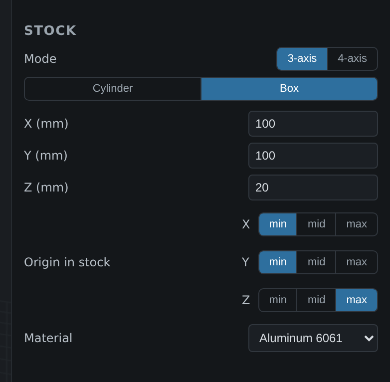
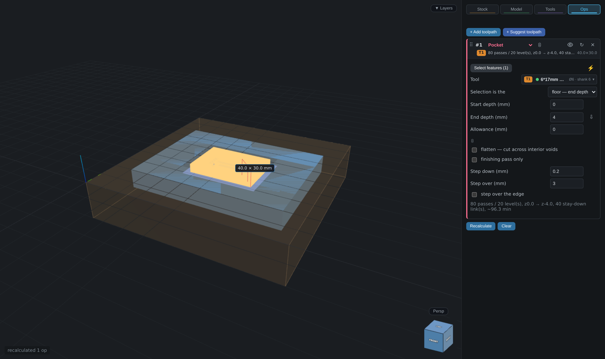
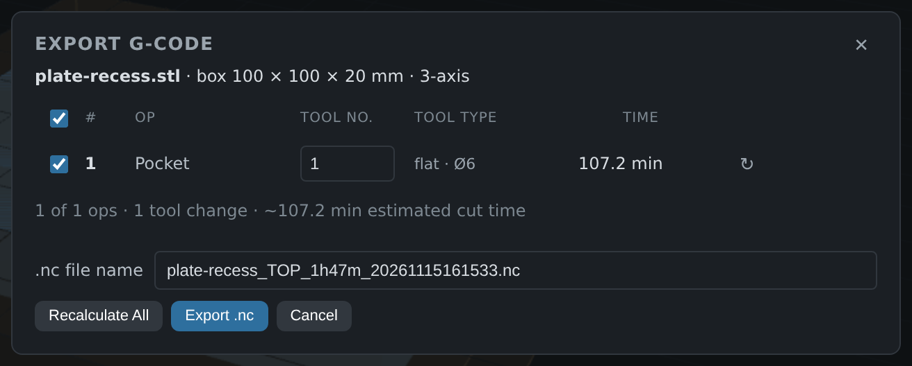

# Your first cut

One complete job, from a fresh app to a file the machine can run: set
up [stock](../glossary.md#stock), get a model in, cut it, export
[G-code](../glossary.md#g-code). This page shows the minimum clicks for
each stage. The details — every depth field, every toggle — live on the
pages this walkthrough links to.

## 1. Set up the stock

The app opens on the Stock tab. It starts you on a Ø100 × 100 mm
cylinder in 4-axis mode — click **Box** for a first flat job.

Fill in **X (mm)**, **Y (mm)**, and **Z (mm)** to match your real blank,
exactly. **Origin in stock** picks where the job's
[work origin](../glossary.md#work-origin) sits — X0, Y0, Z0. Corners
(`min`) are the usual choice. **Material** is a dropdown; the app uses
it to default feeds and speeds later.

<!-- CAPTURE: Stock tab, Box selected, X 100 / Y 100 / Z 20 showing,
     Origin in stock grid on min/min/max, Material dropdown open or on
     Aluminum 6061, Mode on 3-axis. Framing: loose crop of the Stock
     panel, not the whole window -->

*Figure 1 — The origin grid sets X0/Y0/Z0 on the blank; the machine
counts every cut from there.*

## 2. Get a model in

Drag an STL file anywhere onto the app window. STEP, SVG, DXF, and
PNG/JPEG work too — dropping a saved `.cam.json` reopens a whole job.
The Model tab opens with your model placed in the stock.

No model handy? On the Model tab, **+ Box** or **+ Cylinder** under
**Objects** adds a primitive you can cut right away.

**3D-printing analogy:** this is the "import model into the slicer"
step, with one difference — the model only marks what to keep. The
stock is what actually gets cut.

## 3. Add one Pocket op

Open the Ops tab and click **+ Add toolpath**. That appends a Pocket
[op](../glossary.md#toolpath) with the last-used tool (on a fresh job,
the tool library's Ø6 flat [end mill](../glossary.md#end-mill)) and
opens its row.

On the row, click **Select features**, then click a flat face on your
model in the viewport. The face highlights and joins the op.

That's the whole flow. Depth, [step-down](../glossary.md#step-down),
[step-over](../glossary.md#step-over), allowances — the full setup is
the Pocket page's job, not this one: see [Pocket](../ops/pocket.md).

## 4. Recalculate and read the preview

Click **Recalculate** at the bottom of the Ops panel. The app generates
the toolpath and turns the preview on.

In the viewport, amber lines are cutting moves. Red lines are rapids —
non-cutting travel between cuts. The op row shows how many passes it
made and a time estimate.

Sanity-check three things: the passes cover your region, nothing cuts
outside the stock, and the depths are what you meant.

**Caution:** Start depth and End depth measure down from the stock's
[crown](../glossary.md#crown) — the stock's top surface, not your
model's. A model sitting 2 mm below the crown cuts 2 mm of air first.
The rules are in [Fields every operation shares](../reference/fields.md#depths).

For a closer look, the header's **Simulate…** button carves the
toolpaths out of a virtual stock.

<!-- CAPTURE: one Pocket op after Recalculate, row expanded, toolpath
     preview on in the viewport over the stock — amber cut passes plus a
     red rapid, op row showing its pass count and time. Framing: loose
     crop of the viewport with the op row visible -->

*Figure 2 — Read amber as the cut and red as travel; red lines
shouldn't cross anything you care about.*

## 5. Save the job

The header's **Save job** button downloads `<model-name>.cam.json` (or
`job.cam.json` if no model is loaded). The file is self-contained — it
embeds the model, the stock, and every op. Reopen it later with
**Open job…** or by dropping it back on the window.

Until you save, the header shows a **● unsaved** marker whenever
anything changes.

## 6. Export the G-code

Click **Export g-code** in the header. The dialog shows one row per op:

- a checkbox — untick an op and it stays out of the file,
- **Tool no.** — the controller tool number, seeded from the Ops panel
  and editable here. The machine shows it on the tool-change prompt, so
  it must match your physical tool slot,
- **Tool type** and a per-op time estimate.

An op that failed to generate is dimmed with its error shown and can't
be ticked. The totals line reads out ops included, tool changes, and
estimated cut time. The **.nc file name** field is pre-filled; change
it if you like, then click **Export .nc** and the file downloads.

<!-- CAPTURE: Export g-code dialog open over the one-pocket job — one
     checked row with a tool number filled in, tool type, a time
     estimate, totals line below, .nc file name field. Framing: crop of
     the dialog itself, full detail -->

*Figure 3 — Tool no. is the slot your tool sits in on the machine; get
it wrong and the machine changes to the wrong tool.*

Take the `.nc` file to the machine, open it in the Carvera Community
Controller, and follow its flow from there — the controller's own docs
cover that part.

## 7. Before you press go

The software is the safe part of this hobby. The machine is the part
that can hurt you or itself, and it trusts you on three things:

- **The stock cannot move.** Clamp it so nothing shifts. A part that
  comes loose grabs the tool and breaks something.
- **The tool is seated tight** in the [collet](../glossary.md#collet),
  and it's the tool the file expects. The export dialog's tool number
  is your checklist here.
- **The work origin is real.** The machine cuts where you told it the
  stock is — probe or jog to the origin your stock setup declared.

Then start the job and watch the first pass with a hand near stop. If
the preview showed the right thing, the file cuts what you saw. First
job? Use scrap, and keep the depth shallow.
