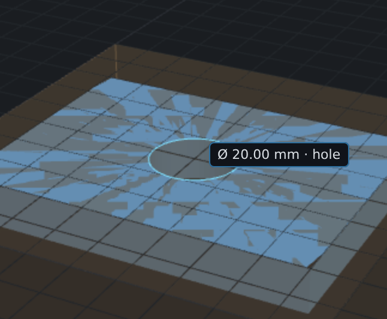
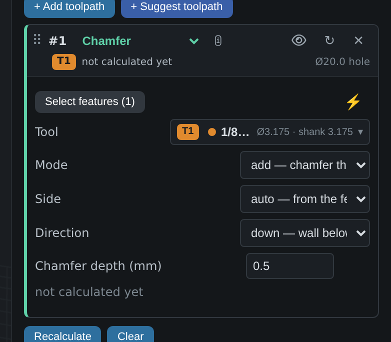
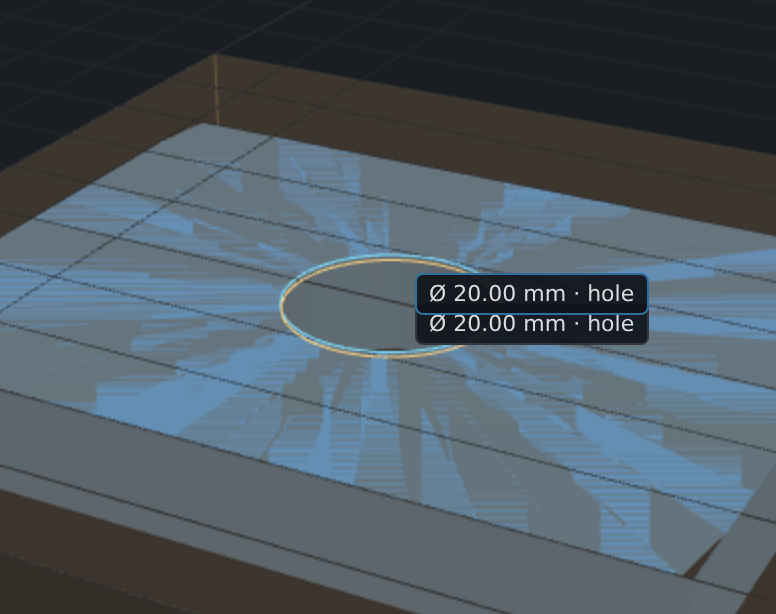

# Chamfer

Runs a [chamfer](../glossary.md#chamfer) bit along selected edges — a small flat where a sharp 90° corner used to be.

*In 3D printing terms:* it's your slicer's elephant-foot compensation — the small bevel on a print's bottom edge that stops the first layer flaring out on the bed. Same shape here, cut in metal with a cone-shaped bit.

## What it is

You point Chamfer at circles or flat faces. A [V-bit](../glossary.md#v-bit) traces each edge once — a single pass, no depth ladder. The cone's slanted side (the flank) does the cutting, so the flat's width comes from the bit's included angle — the cone's full tip angle, set per tool in the [tool library](../reference/tool-library.md). Width = depth × tan(angle ÷ 2). A 90° bit cuts a flat as wide as it is deep.

**Mode** says what the edge is. **add** cuts a new chamfer through a sharp corner. **existing** rides a chamfer the model already has — a cleanup pass on the modelled face. There, **Direction** records which end you clicked: **up** = the bottom edge, traced exactly with depth ignored; **down** = the top edge, and the tip slides down-and-in by the depth. When the depth matches the model's chamfer, both anchors land on the same cut.

## When you'd use it

- Break the sharp top edges of a flat part — select the top face and its whole outline gets the flat.
- Funnel a hole's mouth so a screw head seats flush — select the hole.
- Dress the edge around a [boss](../glossary.md#boss) or a rectangular pocket.
- Clean up a chamfer the model already shows, in **existing** mode.
- Edges on the side of a part in 4-axis work — freeze the stock with an [Index](../glossary.md#indexing) op, then chamfer the rotated face.

## How to use it

1. **Add the op.** `+ Add toolpath`, pick Chamfer, assign a tool. The op takes V-bits only — the shipped Chamfering Bit is a 90° cone; see [Tools and materials](../concepts/tools-and-materials.md).

2. **Point it at the edges.** Click `Select features` on the op row, then click in the viewport — the same click-to-select flow as [Pocket](pocket.md). Circles and flat faces mix freely in one op. A face contributes its whole outline; a round outline is cut as one exact arc.

<!-- CAPTURE: demo part is a plate 80 x 60 x 10 mm with a centered
     20 mm through-hole, top flush with the stock crown; stock is the
     default 100 x 100 x 20 box, 3-axis job. Chamfer op added via
     + Add toolpath, row expanded, Select features armed, the hole
     rim clicked and highlighted — the op row shows "Select features
     (1)". Framing: loose crop of the viewport area with the
     highlighted rim — not the whole window. Shots at
     deviceScaleFactor 2 -->

*Figure 1 — One click per edge: a circle chamfers its own mouth, a face chamfers its whole outline.*

3. **Set the fields.** Four, all Chamfer's own — the ⚡ popup's feed, plunge and clearance are shared semantics in [Fields every operation shares](../reference/fields.md).

   - **Mode** — add or existing, as above.
   - **Side** — auto rides the empty side of the edge: into a hole's mouth, outward around a boss outline. Force **inside** or **outside** when the geometry can't tell them apart.
   - **Direction** — in add mode: down = wall below the edge, up = wall above it. In existing mode the labels change meaning: up = you clicked the bottom edge, down = the top edge.
   - **Chamfer depth (mm)** — default 0.5. How far along the wall the flat reaches from the edge.

<!-- CAPTURE: the same Chamfer op, panel expanded: tool is the shipped
     Chamfering Bit (90° vbit chip on the tool row), Mode "add", Side
     "auto", Direction "down", Chamfer depth 0.5 — all at the new-op
     defaults, op not yet calculated. Framing: crop of the Ops panel
     around the chamfer row, a little margin around it. Shots at
     deviceScaleFactor 2 -->

*Figure 2 — Switch Mode to "existing" and the Direction options reword: they become which end of the modelled chamfer you clicked.*

4. **Recalculate.** The preview draws one amber ring per circle edge, [rapids](../glossary.md#rapids) red. The op row's summary counts what it cut: loops, the depth, and a time estimate.

<!-- CAPTURE: the same job after Recalculate — toolpath preview on in
     the viewport, a single amber ring chamfering the hole's mouth
     (rapids red) around the 20 mm hole; op row summary reads
     "1 loop(s), 0.5mm chamfer, ~X min" with the exact minute figure
     the demo job produces. Framing: loose crop of the viewport with
     the amber ring. Shots at deviceScaleFactor 2 -->

*Figure 3 — Read the preview as edge coverage: one ring per selected edge, and the ring sits where the flat's deepest point lands.*

5. **The gotcha.** The cone must reach. Depth × tan(angle ÷ 2), plus half the tip's flat, has to fit within the bit's radius — generation fails with "needs X mm of flank — the Ø… bit's cone is too short" when it doesn't. Shrink the depth or pick a wider-angle bit.

## Tips & pitfalls

- **Let the app measure the angle.** Arm `+ Suggest toolpath` and click a modelled chamfer. The suggestion reads the wall's cone angle off the mesh and picks a V-bit within 15° of it — the 90° chamfering bit for a modelled 45° wall, not the 60° engraver.
- **A broken rim is refused.** A partial circle has no 360° path to trace, so the op rejects it — select the full circle, or the flat face around it.
- **In indexed work, a bore is one edge.** Both rims of a through-hole read as one loop, anchored on the mouth facing the tool. Select either end and you get the same cut.
- **Single pass, by design.** There's no Step down field here — the flank cuts its full geometry in one pass, and the simulator judges that as intended. Too aggressive for the material? Run several Chamfer ops at growing depths.
