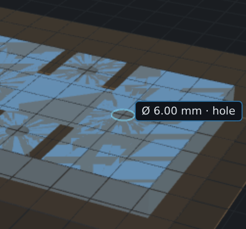
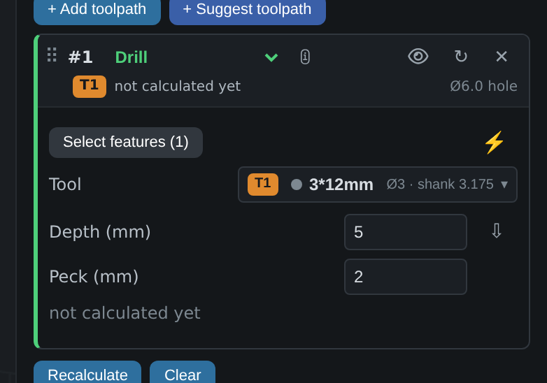
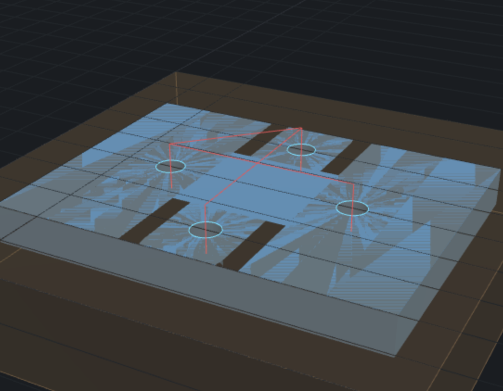

# Drill

Drills straight down the holes you select, in [peck drilling](../glossary.md#peck-drilling) cycles that retract to clear chips.

*In 3D printing terms:* nothing maps here, and that's the point — a printer never rams a spinning tool straight into solid plastic. That plunge is the most violent move in machining, and pecking is how it stays gentle.

## What it is

You select holes on the model — how [selection](../ops/pocket.md) works is Pocket's page — and Drill plunges the tool down each one to a depth measured from the hole's rim. It emits plain moves — a bite, a full retract above the hole to clear [swarf](../glossary.md#swarf), a rapid back down near the bottom, the next bite — rather than the machine's canned drill cycle, so the whole ladder shows in the preview.

The tool cuts only where you point it. Milling a hole out to size — a round pocket where a hole would do — is [Pocket's](../ops/pocket.md) job. Drill makes the hole at the bit's own diameter. When each approach fits, see [Tools and materials](../concepts/tools-and-materials.md).

## When you'd use it

- A straight hole the model already describes: bolt holes, dowel holes, clearance holes.
- The pilot bore before [Thread mill](thread-mill.md) — select the internal thread feature and Drill opens its tap-size bore.
- Many identical holes at once: one op takes the whole bolt circle.
- A hole in 4-axis work: freeze the stock with an [Index](../glossary.md#indexing) op, then drill the rotated face like any flat op.

## How to use it

1. **Add the op.** `+ Add toolpath` → Drill. It appends with the last-used tool and opens the row. Pick a real [drill](../reference/tool-library.md) from the Tool select — a flat end mill can stand in when no drill fits, but the pointed bit is the right tool.

2. **Point it at the holes.** Click `Select features` on the op row, then click hole rims in the viewport. Drill accepts circles that bound real holes and internal thread features; the circle's axis has to run along the machine drill axis — a rim tilted off vertical is skipped, not drilled. How selection itself works is on [Pocket](../ops/pocket.md).

<!-- CAPTURE: demo part is a plate 80 x 60 x 8 mm with a 4-hole bolt
     circle (Ø6 holes on a 40 mm circle, centered), stock the default
     100 x 100 x 20 box, plate top flush with the crown. Drill op added
     via + Add toolpath, row expanded, Select features armed, one hole
     rim clicked and highlighted — the op row reads
     "Select features (1)". Framing: loose crop of the viewport area
     with the highlighted hole rim — not the whole window -->

*Figure 1 — Click the rim, not the middle: the rim sets where the depth is measured from.*

3. **Set depth and peck.** **Depth (mm)** runs down from the hole's upper rim — not from the stock's [crown](../glossary.md#crown) like the [shared depths](../reference/fields.md#depths). The ⇩ button measures it for you: with a hole selected, click any feature and the depth becomes that rim minus the feature's Z; with no hole selected yet, the first click just selects one. **Peck (mm)** defaults to 2 mm — each bite's depth before the retract. The ⚡ popup holds the rest: **Plunge** comes from the drill row of the [preset tables](../concepts/feeds-and-speeds.md) — 200 mm/min in aluminum — never a fraction of the cut feed, and **Clearance** is the rapid height above each hole, 5 mm by default.

<!-- CAPTURE: the same Drill op, panel expanded: tool a Ø3 drill
     from the Makera library, Depth 5 and Peck 2 at their defaults,
     the ⇩ button idle (no pick armed), op not yet calculated.
     Framing: crop of the Ops panel around the drill row, a little
     margin around it. Shot at deviceScaleFactor 2 -->

*Figure 2 — Peck 0 turns the retracts off: one continuous plunge to depth.*

4. **Recalculate.** The panel's Recalculate button generates the [toolpath](../glossary.md#toolpath) and turns the preview on. Each hole reads as a vertical ladder of cutting moves with rapid retracts between bites; the op row's summary counts the holes and the minutes — "4 hole(s), ~0.4 min".

<!-- CAPTURE: the same job after Recalculate — toolpath preview on in
     the viewport: at each of the 4 hole centers a vertical plunge
     ladder rendered amber (rapids red) — retract columns visible above
     each hole; the op row summary reads "4 hole(s), ~0.4 min", status
     strip "recalculated 1 op". Framing: loose crop of the viewport
     with the hole ladders in view -->

*Figure 3 — Each hole is its own ladder: feed down, rapid out, rapid back near the bottom, feed again.*

5. **The gotcha.** Generation fails with "select holes (interior circles)" when nothing usable is selected — a circle that doesn't bound a hole, or every rim tilted off the drill axis. Check what you clicked; zoom in and re-select.

## Tips & pitfalls

- **Sticky metals want a small peck.** Aluminum at the 2 mm default packs [swarf](../glossary.md#swarf) on deeper holes; drop the peck until the retracts bring chips out with them.
- **Peck 0 is a full-depth plunge.** Fine in wood and plastic; asking it of a small drill in metal is how bits snap.
- **Threads arrive pre-drilled.** The Drill + [Thread mill](thread-mill.md) pair is the standard route: Drill opens the minor diameter, Thread mill cuts the form.
- **Point angle is the bit's business, not the op's.** The tool library records it for drill-type tools, but the path just goes to depth — the app doesn't model the cone a real point leaves at the bottom.
