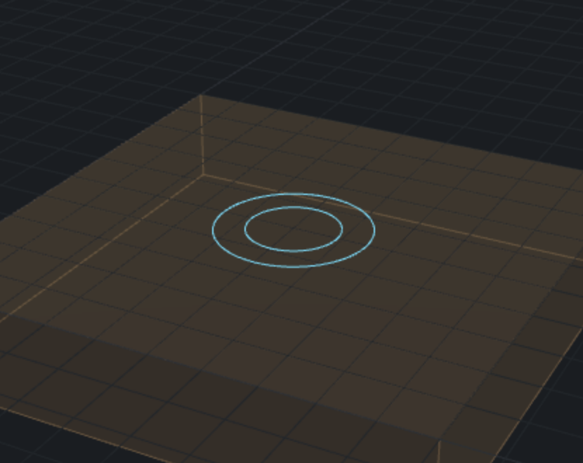
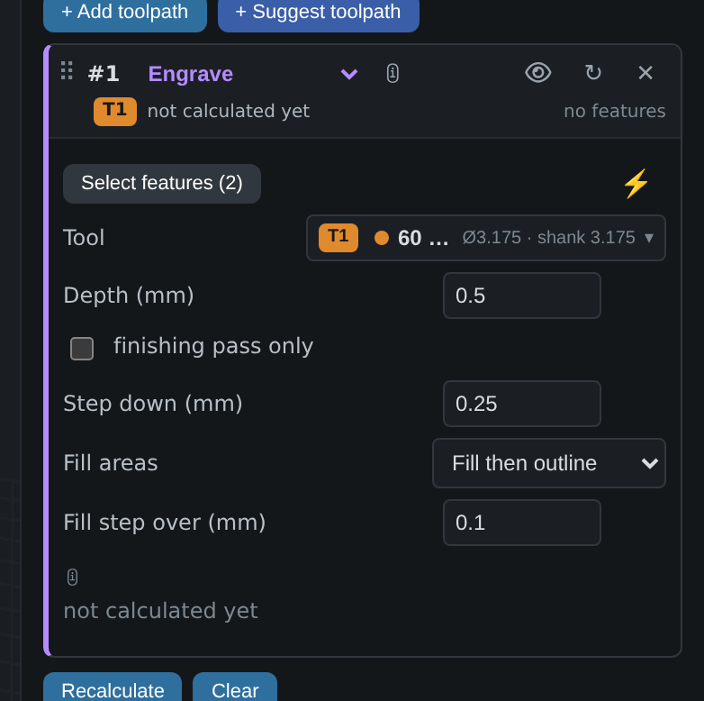
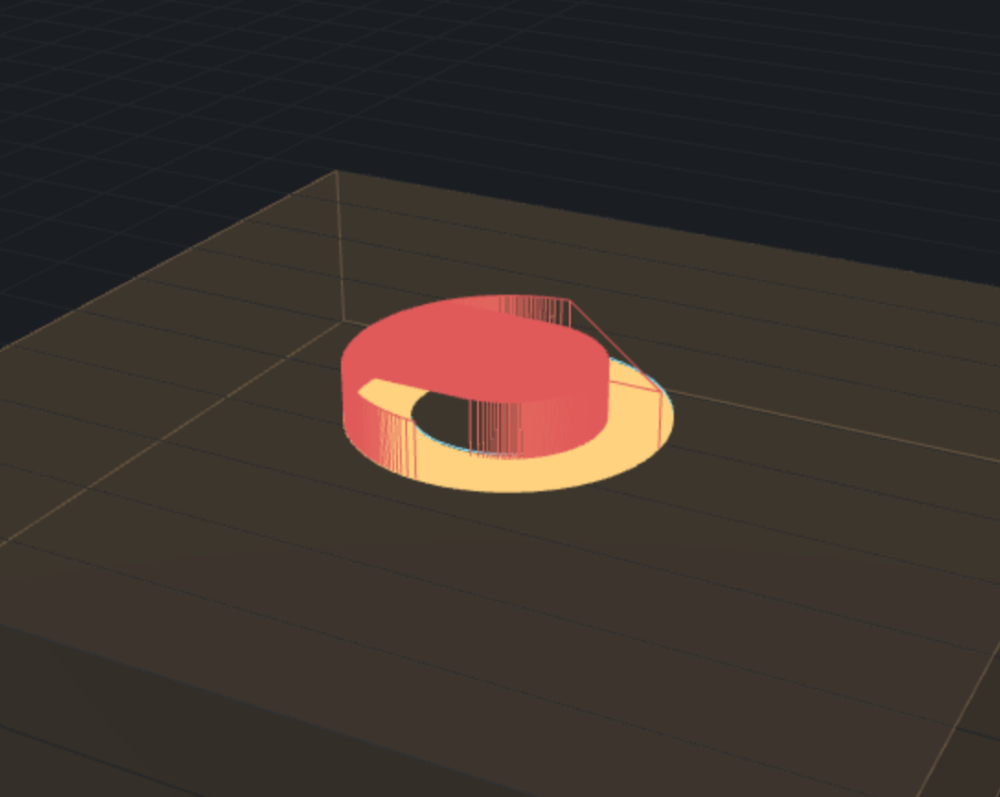

# Engrave

Traces the artwork's lines with the tool centreline — a pen plot with a spinning cutter. The line width IS the tool width.

*In 3D printing terms:* a slicer's line width follows the nozzle. Here the "nozzle" is the cutter tip you load — a thin tip draws a thin line.

## What it is

You drop an SVG or DXF on the viewport to import artwork (see [The Model tab](../the-app/model-tab.md)), then point Engrave at its paths. The cutter follows each line with no side offset — the centreline *is* the line, which is what makes this [engraving](../glossary.md#engraving) rather than profiling. The line width is the tool's tip, not a field.

Flat artwork cuts in its plane. Wrapped artwork bends around the cylinder you point it at — that presentation and its Ø live on the Model tab, covered in [Wrapped artwork](../the-app/model-tab.md#wrapped-artwork).

**Fill areas** adds a raster to closed painted shapes. **Fill then outline** rasters the insides first and traces the outlines on top; **Fill only** rasters alone. The scanlines run along the machine's fast X — axial on a wrapped logo — spaced by [step-over](../glossary.md#step-over)-style **Fill step over**. A hole inside a filled loop (the counter of an "O") stays untouched.

With a [laser](../concepts/tools-and-materials.md) tool the op burns instead of cuts: one pass at the module's focus height. Depth fields don't apply — power rides the S word instead. Each line starts with a short lit run-in (0.3 mm) before its real start, so the beam reaches full power before it touches the artwork — without it, corners where lines begin burn light.

## When you'd use it

- A logo or lettering outline on a flat face.
- A name or band wrapped around a cylinder on the [4th axis](../concepts/the-4th-axis.md).
- Fine linework with a [V-bit](../glossary.md#v-bit) — the pointed tip draws thin lines.
- Filled badge shapes: raster the inside, trace the rim crisp on top.
- Halftone dot screens from an image, burned or engraved as **Fill only**.

## How to use it

1. **Add the op.** `+ Add toolpath`, pick Engrave, assign a tool — a V-bit for line work, the Makera 5W Laser Module for burning. [Tools and materials](../concepts/tools-and-materials.md) covers both.

2. **Point it at the line work.** Click `Select features` on the op row, then click the artwork paths in the viewport — they highlight amber as the op takes them.

<!-- CAPTURE: a simple one-colour SVG logo (a closed ring with an inner
     cutout) dropped on the viewport so it imports as artwork; flat
     3-axis job, stock the default 100 x 100 x 20 box, artwork placed
     on the crown. Engrave op added via + Add toolpath, row expanded,
     Select features armed, both artwork paths clicked and highlighted
     amber — the op row shows "Select features (2)". Framing: loose
     crop of the viewport area with the highlighted artwork, not the
     whole window. Shots at deviceScaleFactor 2 -->

*Figure 1 — Each clicked path joins the op; the count on the button tracks how many you have.*

3. **Set the fields.** **Depth** (mm, default 0.5) measures straight down from the surface the artwork sits on — the artwork's plane when flat, the cylinder surface when wrapped. It's a single depth, not the shared Start/End pair. **Step down** (default 0.25 mm) splits deep cuts into levels that retrace the same lines; **finishing pass only** collapses the ladder to one pass. Both behave as in [Fields every operation shares](../reference/fields.md#step-down-and-step-over).

   Below the depths, **Fill areas** picks the mode. Switching it on reveals **Fill step over**, which defaults from the tool's tip width and re-derives on every tool change — see [Step over and step down](../concepts/step-over-and-step-down.md) for why spacing rides the tool.

<!-- CAPTURE: the same Engrave op, panel expanded: tool is a V-bit
     (e.g. T? 60° V-bit from the shipped library), Depth 0.5 and
     Step down 0.25 at their new-op defaults, finishing pass only
     unticked, Fill areas set to "Fill then outline" so the Fill step
     over row is visible at its tip-width default, op not yet
     calculated. Framing: crop of the Ops panel around the engrave
     row, a little margin around it. Shots at deviceScaleFactor 2 -->

*Figure 2 — Pick a laser tool and the depth fields disappear: a beam burns one pass, so depth has nothing to climb.*

4. **Recalculate.** The preview draws the traced lines amber in the viewport, [rapids](../glossary.md#rapids) red. The op row's summary counts what it cut: paths, fill lines, depth, and a time estimate.

<!-- CAPTURE: the same job after Recalculate — toolpath preview on in
     the viewport, amber engraving lines tracing the logo outline plus
     the fill raster inside the ring (the hole in the middle stays
     clear); op row summary reads "2 path(s) + N fill line(s), 0.5mm
     deep, ~X.X min" with the exact pass and time counts the demo job
     produces. Framing: loose crop of the viewport with the amber
     preview. Shots at deviceScaleFactor 2 -->

*Figure 3 — Read the preview as the drawing itself: every amber line is a pass, and the fill lines should tile the shape with no bald gaps.*

5. **The gotcha.** One op cuts in one frame. Select flat and wrapped artwork in the same op and generation fails — split them into separate Engrave ops, one per presentation.

## Tips & pitfalls

- **Wrapped cuts ignore Index.** The artwork's angular position is set on the Model tab and the cut goes exactly there; an [Index](../glossary.md#indexing) op before the engrave changes only the machine's approach. Keep `spin°` clear of ±180°, where the wrap closes.
- **Depth widens a V-bit's line.** The tip sets the width at a shallow cut; a cone gets wider as it goes deeper, so a deep "thin" line isn't. The [V-bit](../concepts/tools-and-materials.md) section has the geometry.
- **Halftone art wants Fill only.** A dot screen from an image is thousands of tiny closed rings — raster them, skip the tracing. The artwork import offers the halftone route on [The Model tab](../the-app/model-tab.md#loading-a-model).
- **Caution:** engraving plunges straight down at each path start — no ramp, no [lead-in](../glossary.md#lead-in). Keep depths shallow and let Step down carry the ladder.
