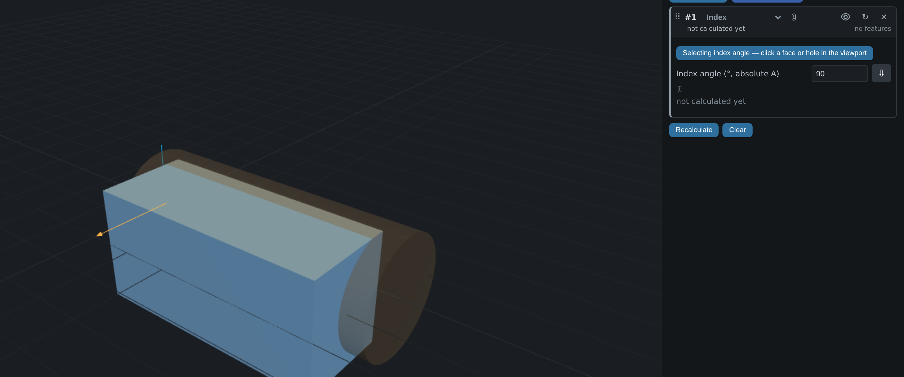
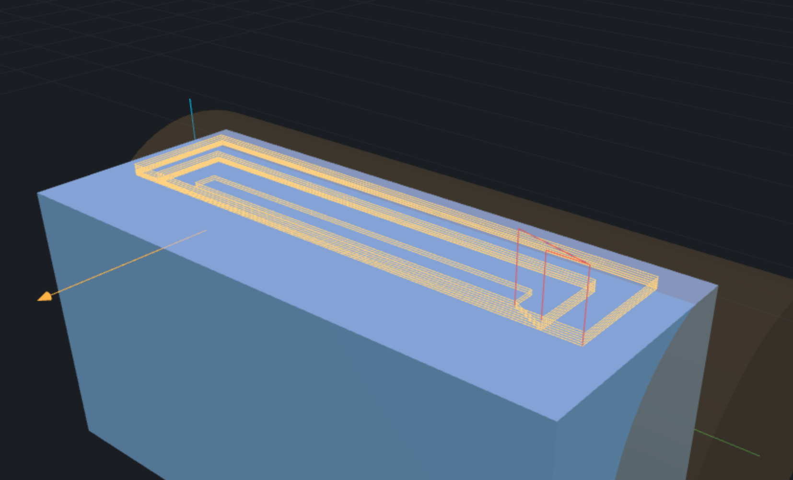

# Index

Rotates the stock to an angle and freezes it there — every op below runs on the rotated face.

*In 3D printing terms:* re-orienting the print on the bed, mid-job — except the machine does the turning, to a tenth of a degree, without you touching the part.

## What it is

An Index op cuts nothing. It positions: the [A axis](../glossary.md#a-axis) turns to the angle you set and the stock freezes there. Every operation below it in the list — a pocket, a profile, a drill — then cuts in that rotated frame, treating the facet now facing up as if it were the top.

The angle is a datum, not a motion each op repeats. The exported [G-code](../glossary.md#g-code) carries one A positioning move at the Index; the flat moves after it are ordinary XYZ cutting, valid as-is.

## When you'd use it

- Four flat sides from one setup: index 90° between pockets and never re-fixture.
- A radial hole through a round part — index so the bore faces up, then drill.
- Pocketing or profiling a facet no 3-axis reach can get at.
- Roughing around a bar at several angles, like the waterline op does.

## How to use it

1. **Add the op.** Set the stock to 4-axis mode on the Stock tab first — the row warns "indexing needs 4-axis mode (Stock tab)" without it. `+ Add toolpath`, then set the kind select to **Index**. A new op starts at 90°.

2. **Set the angle.** Type degrees into **Index angle (°, absolute A)**, or arm the ⇩ pick and click a face or hole in the viewport — its normal (or axis) rotates to face straight up. The panel notes it: the stock freezes at this A, and every op below runs in the rotated frame.

<!-- CAPTURE: 4-axis cylinder stock (Ø25 x 60 mm rod in the default
     4-axis pose), an Index op added via + Add toolpath with the kind
     select switched to Index, angle box at its 90 default, the ⇩ pick
     ARMED (button active) and a model face highlighted in the
     viewport (a box model's side face works if a model is loaded; if
     not, stock-only state with the armed button is fine — capture the
     real state you can build). Framing: loose crop of the Ops panel
     row plus the viewport highlight. Shot at deviceScaleFactor 2. -->

*Figure 1 — The ⇩ pick turns "which way does this face point?" into an angle: its normal rotates to face the cutter.*

3. **Stack flat ops beneath it.** Add the cutting ops after the Index — they inherit the rotated frame automatically. One Index per orientation: re-index by adding another Index further down the list with a new angle.

<!-- CAPTURE: the same job — the Index op (angle 90) above a Pocket op
     in the ops list, the Pocket's preview drawn on the ROTATED face
     after Recalculate; the Index row's summary reads
     "index A90° (datum for the ops below)". Framing: loose crop of
     the Ops panel showing both rows plus enough viewport to see the
     rotated preview. Shot at deviceScaleFactor 2. -->

*Figure 2 — The row reads "index A90° (datum for the ops below)": a position, not a cut.*

4. **Read the preview.** The viewport shows the stock at the indexed angle with the following ops' previews drawn in the rotated frame — what you see is what the machine cuts.

<!-- CAPTURE: after Recalculate — the stock displayed rotated to the
     index angle with the following op's amber toolpath on the rotated
     facet (rapids red); the full ops list visible. Framing: loose
     viewport crop. Shot at deviceScaleFactor 2. -->

*Figure 3 — What the preview shows at the index angle is what the machine cuts there; trust it over mental rotation.*

5. **The gotcha.** Order matters. The Index sets the datum for everything *below* it in the list — drag ops above it and they cut in the old frame. The datum is always the latest Index above the op.

## Tips & pitfalls

- **The axis never unwinds.** After a later op piles up turns, the next Index takes the shortest path to its angle and re-zeroes the A datum — no spinning back through everything.
- **Index ops carry no tool.** They take no [controller tool number](../the-app/tools-tab.md#the-t-number-labels) and no rates — there is nothing to spin.
- **Indexing is 4-axis work; indexed cutting is 3-axis work.** The ops beneath run as ordinary flat cuts — see [The 4th axis](../concepts/the-4th-axis.md) for the boundary, and [Stock and origins](../concepts/stock-and-origins.md) for where depths hang from in the rotated frame.
