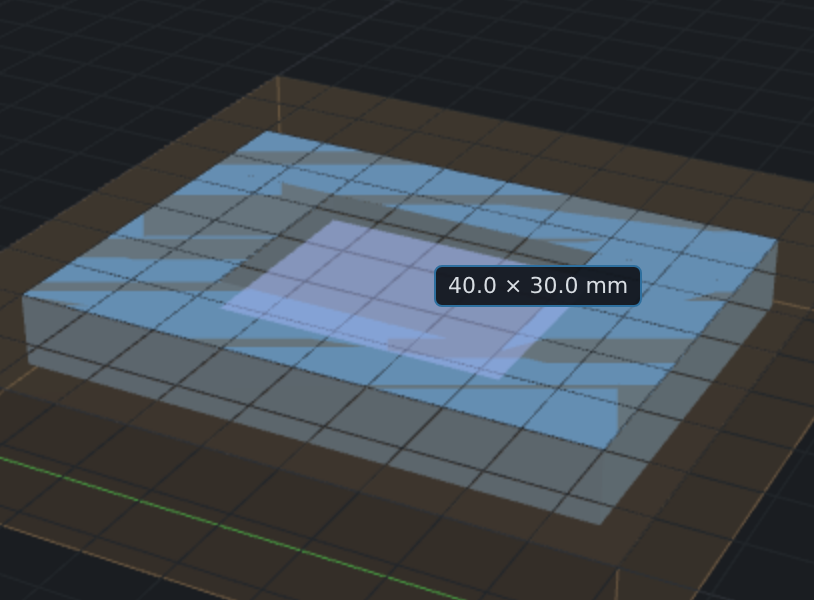
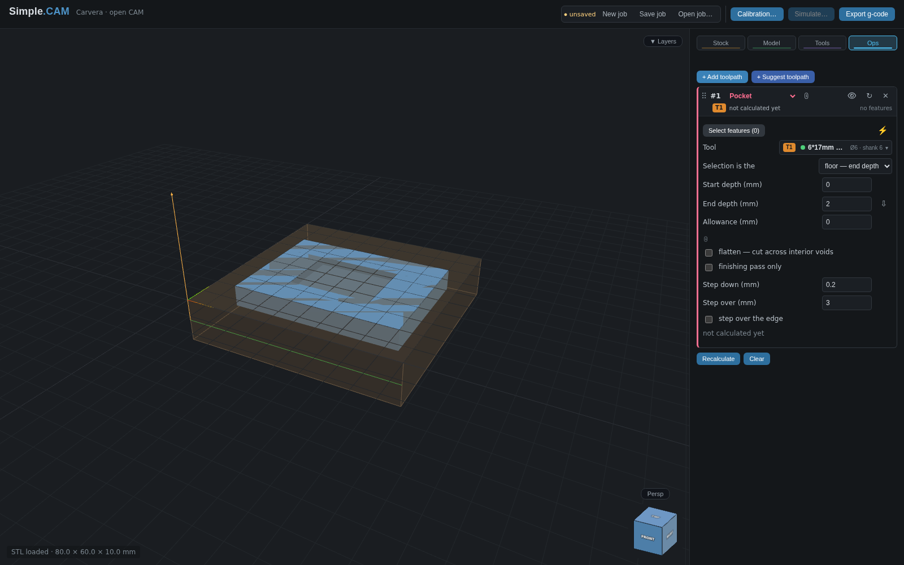
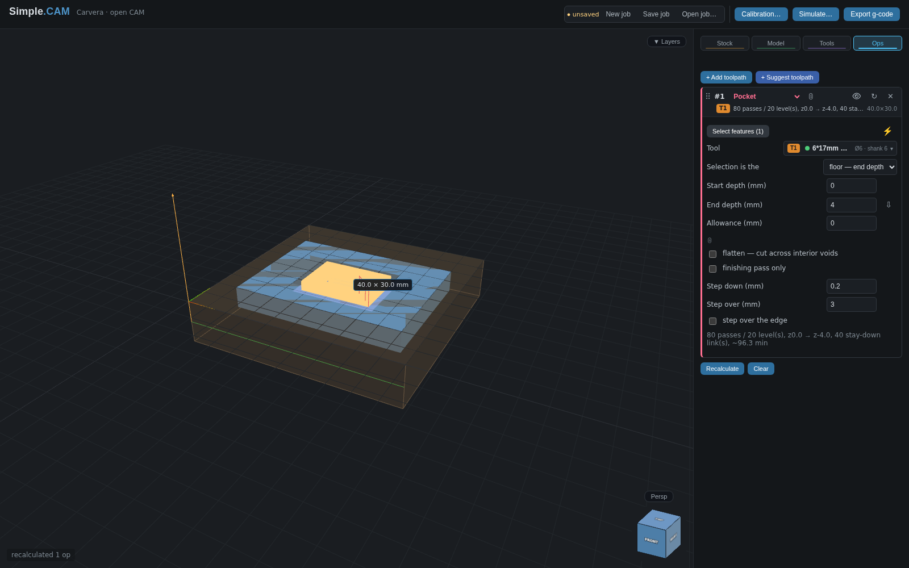

# Pocket

Clears a closed area down to a set depth. The workhorse: any flat recess, cavity, or face that needs material gone.

*In 3D printing terms:* a pocket is the infill routine for a cavity — fast bulk removal, then a clean wall and floor pass.

## What it is

You point Pocket at flat faces or circles (holes) on the model. It steps the region down in depth levels and clears each level with passes offset inward from the outline. Entries ramp or helix in — the tool never plunges straight into material — and every pass cuts [climb milling](../glossary.md#climb-milling).

The clearing strategy picks itself, the same way climb does. A narrow region gets one continuous helical descent. A deep bulk cut — more than two tool diameters deep, with room to loop — switches to [adaptive clearing](../glossary.md#adaptive-clearing): steady-engagement loops instead of full-width passes. There's no knob for either.

## When you'd use it

- A recess or cavity in a flat part: clear the interior, leave the walls.
- Holes you want milled, not drilled — select the hole circles.
- Roughing a cavity ahead of a finishing pass (the rough + finish pairing below).
- A clean floor on a patch of the stock top.
- A round seat for a bearing, magnet, or nut.

## How to use it

1. **Add the op.** `+ Add toolpath` appends a Pocket with the last-used tool and opens its row.

2. **Point it at the region.** Click `Select features` on the op row, then click in the viewport. Flat faces become cut regions; circles become round pockets. One op takes faces or holes — not both. For the other kind, add a second op.

<!-- CAPTURE: demo part is a plate 80 x 60 x 10 mm with a centered
     40 x 30 mm recess, floor 4 mm below the stock crown; stock is the
     default 100 x 100 x 20 box, plate top flush with the crown. Pocket
     op added via + Add toolpath, row expanded, Select features armed,
     the recess floor clicked and highlighted — the op row shows
     "Select features (1)" and End depth has auto-prefilled to 4 from
     the picked floor. Framing: loose crop of the viewport area with
     the highlighted floor — not the whole window -->

*Figure 1 — Clicking the floor attaches it to the op; the ⇩ prefill has already set End depth from it.*

3. **Set the fields that matter.** [Start depth](../reference/fields.md#depths) and End depth: where the cut band starts and ends, measured down from the stock's [crown](../glossary.md#crown). Clicking the ⇩ button takes this measurement direct from the model — select a highlighted feature and the field fills with it. [Step down](../glossary.md#step-down) and [step-over](../glossary.md#step-over) default to the tool's preset and half its diameter. [Allowance](../glossary.md#allowance) leaves a skin on the walls and floor for a finishing pass. The shared semantics — depths, allowances, the ⇩ picks — are all in [Fields every operation shares](../reference/fields.md).

   Two pocket toggles sit below: **finishing pass only** skips the roughing ladder (it hides Step down and zeroes Allowance), and **flatten** cuts across interior voids — off by default, so islands stay standing.

<!-- CAPTURE: the same Pocket op, panel expanded: tool T1 (Ø6 flat),
     Start depth 0, End depth 4 filled by the ⇩ floor pick (link
     active), Step down 0.2 and Step over 3 at their defaults,
     flatten and finishing pass only unticked, cut past the stock edge
     unticked, op not yet calculated. Framing: crop of the Ops panel
     around the pocket row, a little margin around it -->

*Figure 2 — Hand-editing End depth detaches the ⇩ link; the number wins until you pick again.*

4. **Recalculate.** The panel's Recalculate button generates the [toolpath](../glossary.md#toolpath) and turns the preview on. Cutting moves render amber, [rapids](../glossary.md#rapids) red; the ⚡ popup on the op row holds feed and spindle, defaulted from the tool's preset for the stock material.

<!-- CAPTURE: the same job after Recalculate — toolpath preview on in the
     viewport, contour-offset cutting moves rendered amber (rapids red)
     covering the 40 x 30 mm region down to the 4 mm floor; the op row
     reads "80 passes / 20 level(s), z0.0 -> z-4.0, 40 stay-down link(s),
     ~96.3 min" (truncated with an ellipsis when collapsed; full text on
     hover), status strip "recalculated 1 op". Framing: loose crop of
     the viewport with the amber preview -->

*Figure 3 — Read the preview as coverage: the passes should tile the whole region with no untouched islands.*

5. **The gotcha.** Generation fails with "select either faces or holes for this operation, not both" when the selection mixes kinds. Split it: one Pocket for the faces, one for the circles.

## Tips & pitfalls

- **Rough + finish:** set Allowance around 0.2 mm on the first op, then add a second Pocket, point it at the same features, and tick **finishing pass only** on it. The rough clears the bulk, the finish takes the skin. See [Fields every operation shares](../reference/fields.md#finishing-pass-only).
- **Deep pockets go adaptive on their own.** When the cut is deeper than two tool diameters and the region has room to loop, roughing runs as steady-engagement loops at derived step-down and feed rates. The ⚡ popup shows the numbers and why they changed — they're derived, never fields.
- **Caution:** **cut past the stock edge** grows the cut region by one step-over past the selected outline, and past the stock edge the same way. Tick it only when nothing of value sits within one step-over outside the region — the setting is a vouch, not a trim.
- **Islands:** leave **flatten** off to keep material standing inside the region. Turn it on only when the interior voids are junk you want gone.
