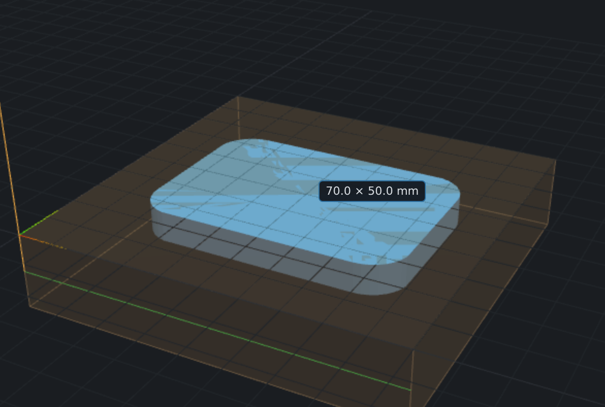
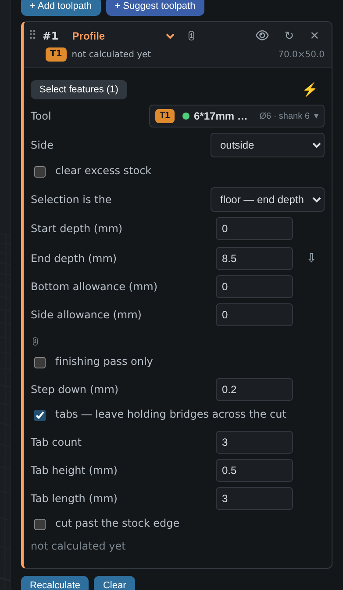
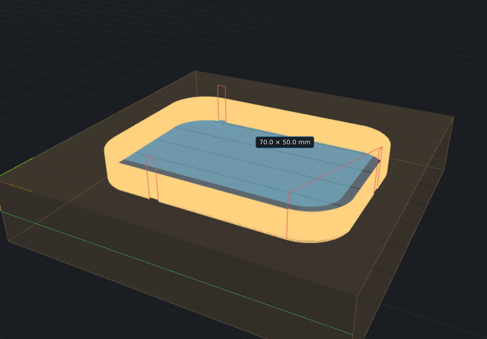

# Profile

Cuts around a shape following its outline, offset to one side — how a part separates from the stock around it.

*In 3D printing terms:* Profile is the print's outer wall — one loop around the shape, drawn in material removal instead of extrusion. The [tabs](../glossary.md#tabs) are the sprue that keeps a model-kit part attached until you snip it free.

## What it is

You point Profile at flat faces or circles on the model. The tool then runs one loop per depth level around the outline, offset to the side you pick: **outside** cuts around the shape, **inside** follows a hole's rim, **on line** rides the outline itself with no offset. Outside and inside passes cut [climb milling](../glossary.md#climb-milling); on line follows the model's own contour direction. Entries ramp or helix in — a [lead-in](../glossary.md#lead-in) instead of a straight plunge.

## When you'd use it

- Cutting a part free from the surrounding stock — the classic cut-out, held by tabs until the job ends.
- Trimming a boss down to a target diameter with a negative side allowance.
- Finishing a wall after a roughing pass — inside, with the allowance removed.
- Tracing an outline on the line, engrave-style, with any flat tool.

## How to use it

1. **Add the op.** `+ Add toolpath` appends an op with the last-used tool; set its kind select to **Profile**. Changing the kind rebuilds the op with new defaults — anything you already selected stays selected.

2. **Point it at the outline.** Click `Select features` on the op row, then click in the viewport. A flat face contributes its outline; a circle contributes its rim. One op takes faces or holes — not both.

<!-- CAPTURE: demo part is a rounded-corner plate 70 x 50 x 8 mm (corner
     radius 10 mm) sitting on the default 100 x 100 x 20 box stock, plate
     top flush with the crown. Profile op added via + Add toolpath, kind
     select set to Profile, row expanded, Select features armed, the
     plate's top face clicked and highlighted — the op row shows
     "Select features (1)". Framing: loose crop of the viewport area with
     the highlighted outline — not the whole window -->

*Figure 1 — Clicking the face attaches its outline to the op; clicking a circle would attach its rim instead.*

3. **Set the fields that matter.** **Side** picks where the tool rides: outside, inside, or on line. [Start depth](../reference/fields.md#depths) and End depth bracket the cut band, measured down from the stock's [crown](../glossary.md#crown); the ⇩ pick fills them from the model. [Step down](../glossary.md#step-down) sets how deep each level goes.

   The two [allowance](../glossary.md#allowance) fields split the roughing stock. **Side allowance** is signed: positive leaves a wall skin for a finishing pass, negative moves the tool path inward and cuts the shape below its modeled size. **Bottom allowance** keeps a skin on the floor when the cut doesn't go through. The shared semantics live in [Fields every operation shares](../reference/fields.md).

   Tick **tabs — leave holding bridges across the cut** for any cut that goes past the part's bottom. Defaults are 3 bridges, 0.5 mm tall and 3 mm long (details in [the fields reference](../reference/fields.md#tabs)): levels above the tab tops cut the full loop, deeper levels cut only the spans between bridges — the part stays attached until the job ends.

   Two toggles sit below. **clear excess stock** (outside side only) appends passes that sweep the leftover waste frame out to the stock wall. **cut past the stock edge** keeps the wall loop intact where it runs out of stock to cut; unticked, the pass clips to the stock edge in open spans.

<!-- CAPTURE: the same Profile op, panel expanded: Side "outside",
     Start depth 0, End depth 8.5, Step down at its default, tabs ticked
     showing Tab count 3 / Tab height 0.5 / Tab length 3, clear excess
     stock unticked, cut past the stock edge unticked, op not
     yet calculated. Framing: crop of the Ops panel around the profile
     row, a little margin around it -->

*Figure 2 — Side allowance is signed: a negative value steps the tool path inward and cuts the shape smaller than modeled.*

4. **Recalculate.** The panel's Recalculate button generates the [toolpath](../glossary.md#toolpath) and turns the preview on. Cutting moves render amber, [rapids](../glossary.md#rapids) red; the ⚡ popup on the op row holds feed and spindle, defaulted from the tool's preset for the stock material.

<!-- CAPTURE: the same job after Recalculate — toolpath preview on in the
     viewport, the wall ring around the plate at every level rendered
     amber (rapids red), with gaps in the deep-level loops where the
     three tabs hold the part; the op row reads "N wall pass(es) /
     M level(s), z0.0 -> z-8.5, ... ~X min" (counts and time as
     generated). Framing: loose crop of the viewport with the preview -->

*Figure 3 — The gaps in the deep-level loops are the tabs; snap the part free and file the nubs once the job ends.*

5. **The gotcha.** An inside profile fails with "profile offset leaves no path — tool too large for an inside profile?" when the tool can't fit inside the loop. Pick a slimmer tool, or switch the side to outside.

## Tips & pitfalls

- **Caution:** a through cut with tabs unticked sets the part free before the job ends — it can break loose and fly. Tick tabs (the defaults: 3 × 0.5 mm × 3 mm) on any cut past the part's bottom.
- **Rough + finish:** set Side allowance around 0.2 mm on the first op, then add a second Profile over the same outline and tick **finishing pass only** on it. Ticking zeroes both allowances and cuts one full-depth wall lap. See [Fields every operation shares](../reference/fields.md#finishing-pass-only).
- **Tabs space themselves.** They sit evenly spaced along the outline by arc length, never straddling the loop's seam, and keep the same positions on every level. A loop too short for the requested count warns and clamps the count.
- **Watch the waste frame.** With **clear excess stock** on, a frame narrower than the tool reports "frame thinner than the tool — waste left standing" and the waste stays put.
