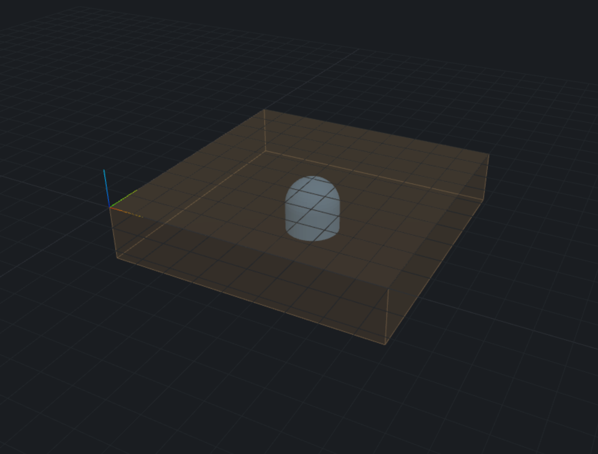
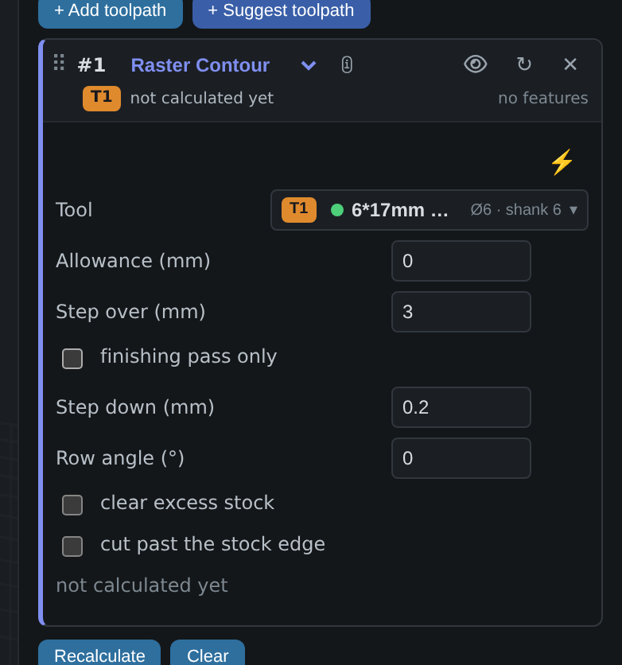
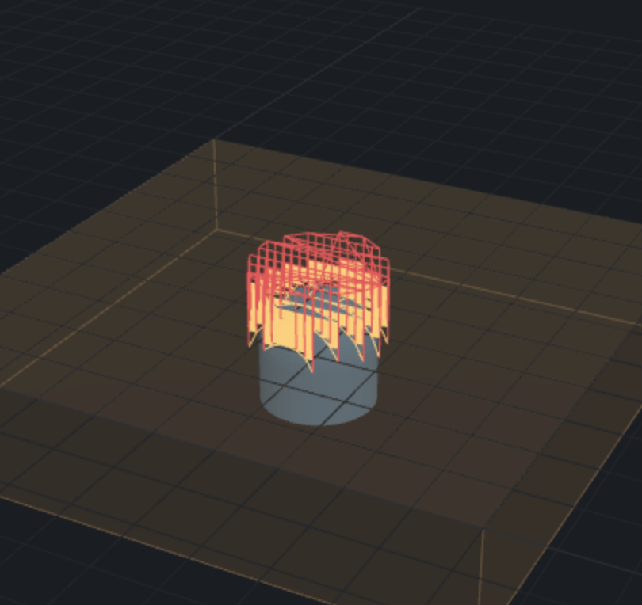

# Raster Contour

The finishing pass that follows the model's actual surface — shallow sweeps in parallel rows, hugging every contour.

*In 3D printing terms:* ironing — the shallow final pass that smooths a top surface. Here the "iron" is your cutter, and it follows curves, not just flats.

## What it is

You load a model and point nothing at nothing: no selection, no depth band. The [crown](../glossary.md#crown) is the ceiling, the model sets every depth. The tool sweeps parallel rows across the whole part, each row's cut depth read off the model's surface — a 3D finish rather than a flat one.

**Allowance** is the only rough-vs-finish knob: 0 cuts to the surface exactly. Untick **finishing pass only** and the op first roughs in flat levels at the Step down — Makera-style ladder — then finishes on the surface. Ticked, it cuts just the surface pass and assumes the rough already ran.

## When you'd use it

- Finishing a curved or organic part after a [Waterline Contour](waterline.md) rough.
- Smoothing relief carvings and heightmap models — anything with real 3D shape.
- The cross-hatch finish: one op at Row angle 0°, a second at 90°.
- Finishing a 4-axis part's facets — it runs in [indexed](../glossary.md#indexing) mode like the waterline does.

## How to use it

1. **Add the op.** `+ Add toolpath`, then set the kind select to **Raster Contour**. A model must be loaded — the surface is the whole input.

2. **Skip the selection step.** There is no `Select features` on this op. The loaded model is the target; nothing to click.

<!-- CAPTURE: demo model is a hemisphere or smooth dome 40 mm Ø on the
     default 100 x 100 x 20 box stock, top flush with the crown.
     Raster Contour op added via + Add toolpath, kind select switched
     to Raster Contour, row expanded, "not calculated yet" — no
     selection highlights anywhere. Framing: loose crop of the viewport
     with the dome and the op row context. Shot at deviceScaleFactor 2. -->

*Figure 1 — No picks to make: the whole loaded model is the target, and its surface sets every depth.*

3. **Set the fields that matter.** **Allowance** (default 0) leaves a skin for a later pass — see [Allowances](../concepts/allowances.md). **Step over** sets row spacing — see [Step over and step down](../concepts/step-over-and-step-down.md). **Row angle** (°, default 0) runs rows along X; 90° runs them along Y; any angle works. The two checkboxes below behave like their names everywhere: **clear excess stock** also flattens the waste out to the stock edge — **Caution:** that can free the part; cut-outs are [Profile's](profile.md) job, tabs and all. **cut past the stock edge** lets the tip cross the stock's boundary.

<!-- CAPTURE: the same Raster Contour op, panel expanded: Allowance 0,
     Step over at its default, Row angle 0, finishing pass only
     unticked with Step down visible, clear excess stock unticked,
     cut past the stock edge unticked, op not yet calculated.
     Framing: crop of the Ops panel around the raster row, a little
     margin around it. Shot at deviceScaleFactor 2. -->

*Figure 2 — Row angle 0° + a second op at 90° gives the cross-hatch finish; each pass alone leaves its own directional texture.*

4. **Recalculate.** The preview draws the parallel sweeps in amber, [rapids](../glossary.md#rapids) red, each row following the surface's rise and fall. The op row's summary counts rows, allowance, and time.

<!-- CAPTURE: the same job after Recalculate — toolpath preview on in
     the viewport, amber parallel rows sweeping across the dome and
     hugging its curve, rapids red between rows; the op row summary with
     its real row count and minutes. Framing: loose crop of the
     viewport with the raster preview. Shot at deviceScaleFactor 2. -->

*Figure 3 — Read the preview as coverage: every part of the surface should sit under a row, and no row should dive deeper than the model.*

5. **The gotcha.** This op assumes the bulk is gone. Started deep on un-roughed stock, generation warns: "deepest plunge N.Nmm below the crown — run a waterline contour first: this op assumes bulk stock is already cleared". Rough first, finish second.

## Tips & pitfalls

- **The pairing that nets the surface exactly:** a [Waterline Contour](waterline.md) at allowance X, then this op at allowance X — the two allowances cancel and the finish lands on the model. Both at 0 works too, but the rough runs faster at its own allowance.
- **Caution: clear excess stock can free the part.** It flattens everything outside the model out to the stock edge — including the material holding a cut-out in. Deliberate cut-outs belong to [Profile](profile.md) with [tabs](../concepts/tabs.md).
- **Texture is directional.** A single-angle finish leaves fine parallel lines. Cross-hatch with a second op at 90° when the part will be seen up close.
