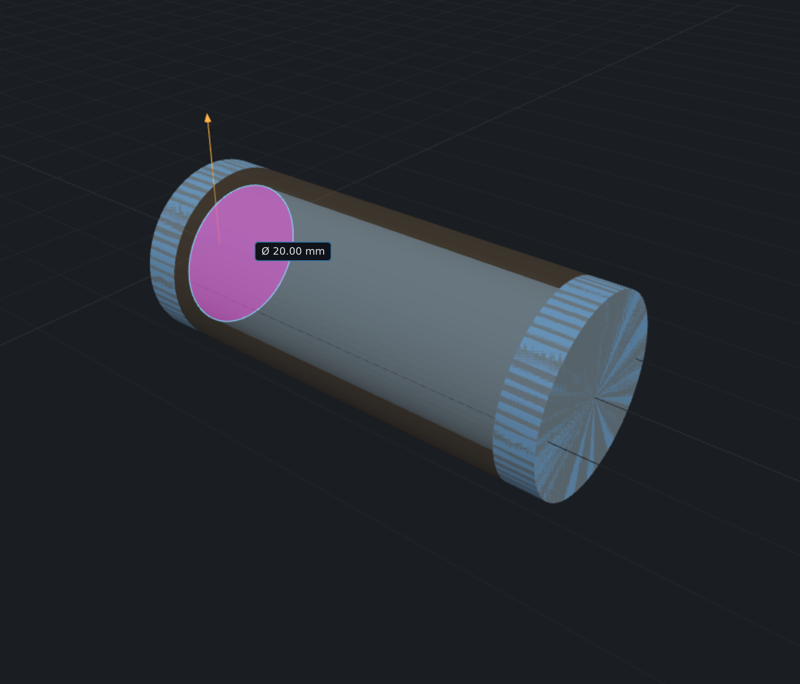
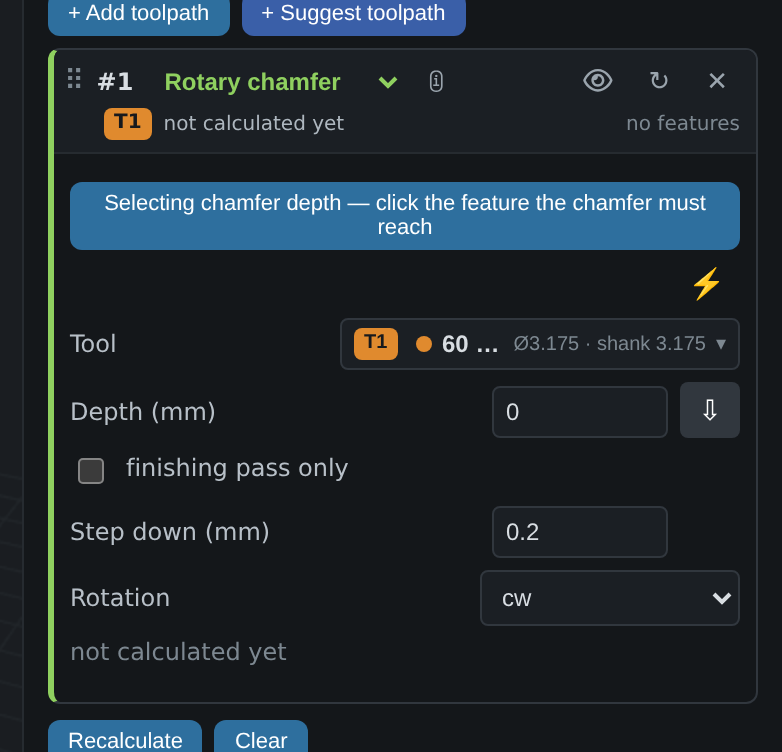
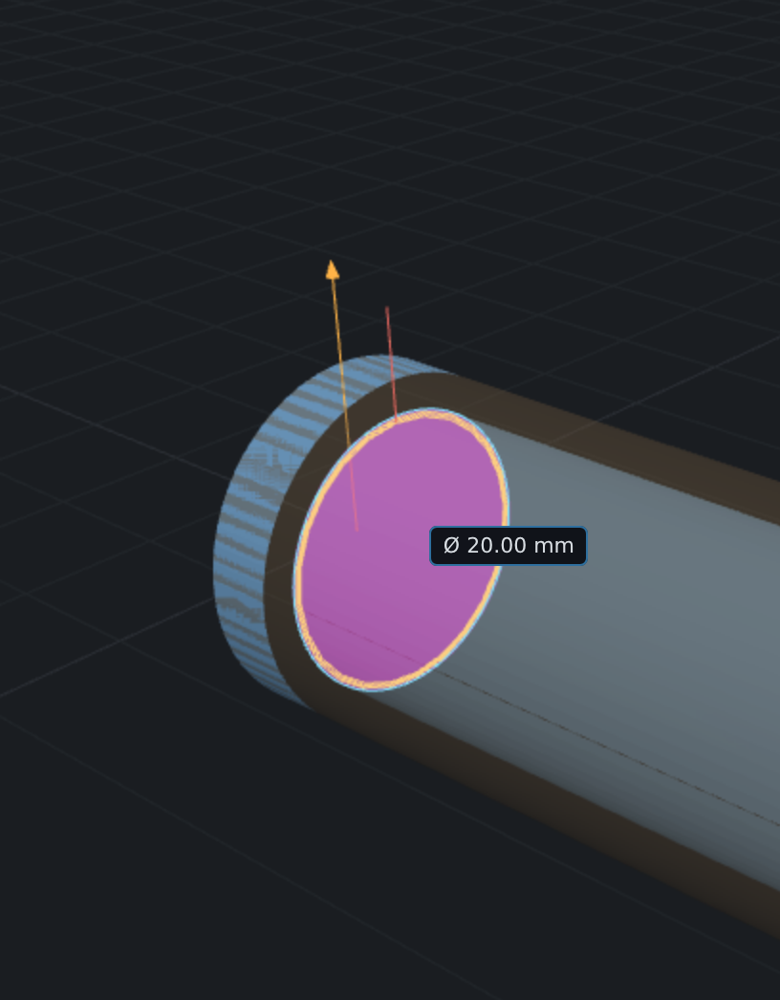

# Rotary chamfer

Chamfers the circles that run around the stock — one full revolution of A at the circle's exact X.

*In 3D printing terms:* the break-edge chamfer, wrapped around a round part — where a flat part gets its sharp edge dressed once, this cuts the same bevel as a ring around a cylinder.

## What it is

You point the op at a circle coaxial with the stock — a step edge from a [Rotary face](rotary-face.md) pass, a rod's end rim, a modelled groove — and the tool sweeps one full A revolution there. A [V-bit](../glossary.md#v-bit) cuts a flat chamfer whose width comes from its cone angle and the depth; a [ball-nose](../glossary.md#ball-nose) cuts rounded fillets and U-shaped channels instead.

**Depth 0** anchors the tip exactly on the circle and cuts up-and-out through whatever rises above it — a step wall, the root of an existing chamfer. **Depth above 0** treats the circle as the highest point: the tip slides below it and the chamfer opens outward — a rod end, a chamfer's top edge.

This is the 4-axis sibling of the flat-work [Chamfer](chamfer.md) op: that one traces edges on a flat part, this one traces rings around a spinning one.

## When you'd use it

- Break the sharp edge where a turned step meets a shoulder.
- Chamfer a rod end so it enters a hole or collet cleanly.
- Round a step's corner with a ball tool — a fillet instead of a flat.
- Cut a decorative U-channel ring around a part.

## How to use it

1. **Add the op.** Set the stock to 4-axis mode first. `+ Add toolpath`, then set the kind select to **Rotary chamfer** and pick the tool: a V-bit for flat chamfers, a ball for fillets and channels.

2. **Point it at the ring.** Click `Select features` on the op row, then click the circle in the viewport. Face ops publish their step rims as selectable circles; the stock publishes its end rims; turned models publish their grooves. The circle must run around the stock — coaxial, at one X.

<!-- CAPTURE: 4-axis cylinder stock (Ø25 x 60 mm), a Rotary face op
     already run so a step edge exists (or a turned model with a
     groove rim), the Rotary chamfer op added with kind select set,
     Select features armed, the step's rim circle highlighted green in
     the viewport — the op row shows "Select features (1)". Framing:
     loose crop of the viewport with the highlighted rim. Shot at
     deviceScaleFactor 2. -->

*Figure 1 — The rim is the anchor: the whole chamfer hangs off this one circle's X and Ø.*

3. **Set the depth.** **Depth (mm)** follows the tool. V-bit: 0 anchors on the circle; a depth slides the tip below it and widens the chamfer outward. Ball: 0 anchors and the upper hemisphere shears a fillet up-and-to-the-side; a depth cuts a U-channel, and depth = the ball's radius gives the full semicircle (width = the tool's Ø). The ⇩ pick measures the depth for you: click the feature the chamfer must reach, and the depth becomes the anchor circle's radius minus that feature's — the valley floor is the natural pick. [Step down](../glossary.md#step-down) splits deep chamfers into levels; **Rotation** picks cw or ccw.

<!-- CAPTURE: the same Rotary chamfer op, panel expanded: tool a 90°
     V-bit (or the shipped Chamfering Bit), Depth 0.5, the ⇩ pick
     idle, finishing pass only unticked, Step down at its default,
     Rotation cw, op not yet calculated. Framing: crop of the Ops
     panel around the rotary chamfer row, a little margin around it.
     Shot at deviceScaleFactor 2. -->

*Figure 2 — The ⇩ pick is a subtraction: the anchor rim's radius minus the reached feature's radius. Pick the valley floor and the tip lands on it.*

4. **Recalculate.** The preview draws the ring: one amber revolution per level at the circle's X, [rapids](../glossary.md#rapids) red. A-only rings run plain G94 at the rotary ceiling — about 6.6 RPM — so a single 360° pass takes about nine seconds and the time estimate says so.

<!-- CAPTURE: the same job after Recalculate — toolpath preview on in
     the viewport, the amber chamfer ring around the stock at the
     picked circle's X (rapids red); the op row summary with its real
     loop count and minutes. Framing: loose crop of the viewport with
     the ring. Shot at deviceScaleFactor 2. -->

*Figure 3 — One ring, one revolution: the summary's minutes are honest about the ~9s a full turn takes at the rotary limit.*

5. **The gotcha.** A ball tool asked for more depth than its radius passes the equator — the shank takes the walls. The app warns and caps the channel's width at the tool's Ø; for a true semicircle, stop at depth = radius.

## Tips & pitfalls

- **Rods chamfer from their end rims.** A rod end is an end rim plus a depth: anchor on the stock's end rim, then set a depth so the tip slides below it and the chamfer opens outward.
- **The flat-work rules carry over.** Width comes from the bit's [flank](../glossary.md#flank) angle — width = depth × tan(angle ÷ 2), the same geometry as the flat Chamfer op.
- **A broken rim is refused.** A partial circle has no 360° path — the op rejects it. Select a complete circle, or the face around it.
