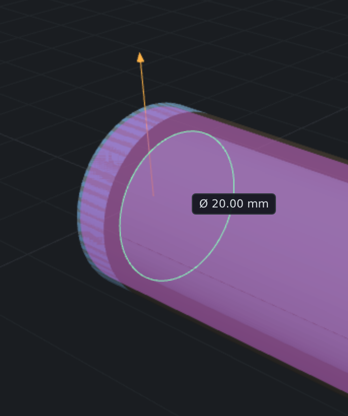
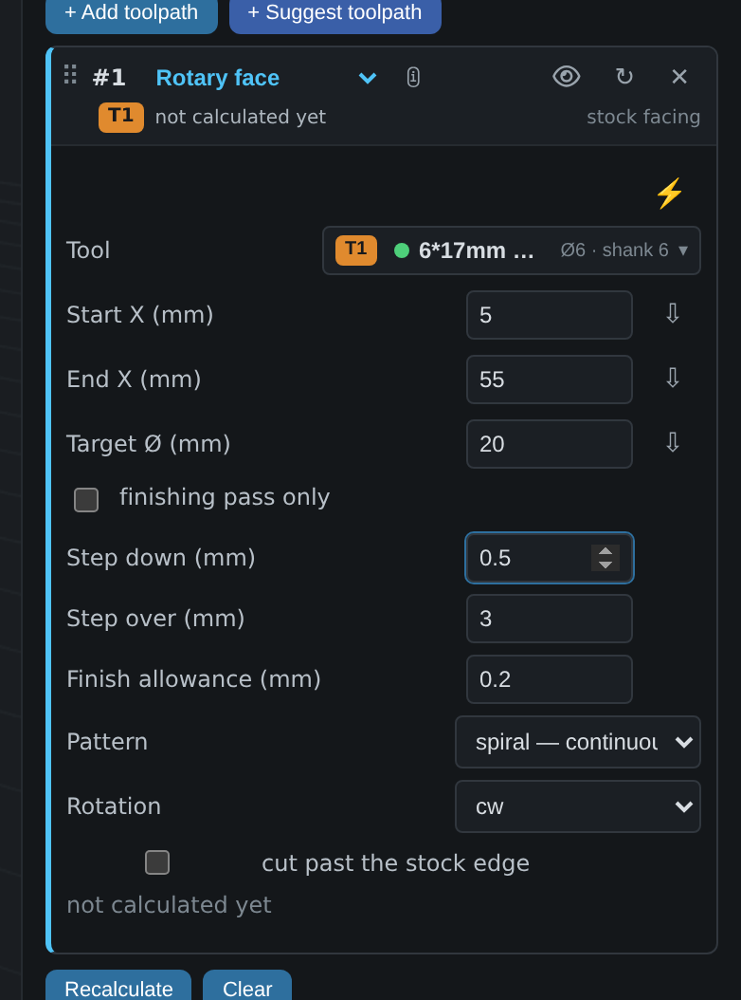
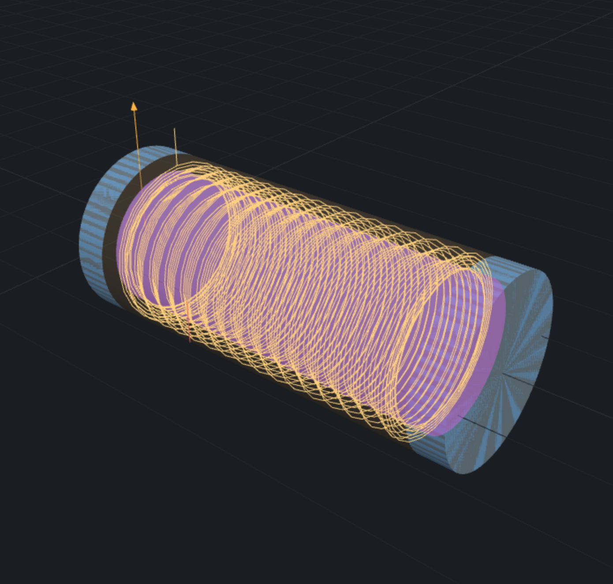

# Rotary face

Turns the stock down to a target diameter over a stretch of its length — a lathe-style turning pass, done with a milling bit on the [A axis](../glossary.md#a-axis).

*In 3D printing terms:* the depth ladder is slicing turned sideways — each level removes one thin ring of material, radially instead of vertically.

## What it is

You set an X range and a target diameter. The tool steps down level by level until the stock reaches that diameter: [roughing](../glossary.md#roughing-pass) levels first, then one [finishing pass](../glossary.md#finishing-pass) at full depth. It needs 4-axis mode — the stock spins while the tool sweeps along X.

Box stock works too: the app faces it as a cylinder of its corner-to-corner radius, so the corners turn off first and early passes cut air over the flats.

## When you'd use it

- Turning a rod down over its middle, leaving full-diameter stubs at each end for the vice or collet.
- Truing a rough blank round before anything detail-oriented.
- Cutting a bearing or shaft seat to an exact diameter.
- Prepping a consistent Ø before threading or grooving the same stretch.

## How to use it

1. **Add the op.** Set the stock to 4-axis mode on the Stock tab first — generation fails without it. `+ Add toolpath` appends an op, then set its kind select to **Rotary face**.

2. **Point it at the diameters.** Start X, End X, and Target Ø each carry a ⇩ pick button: click it, then click a feature in the viewport. Face ops and the stock publish their rims as selectable circles — on a turned part, the finished-Ø circle is the natural Target Ø pick.

<!-- CAPTURE: 4-axis mode, cylinder stock Ø25 x 60 mm aluminum lying on the
     A axis; demo model is the finished part — a rod whose middle section
     is Ø20 (shoulders at X 5 and X 55). Rotary face op added via + Add
     toolpath, kind select switched to "Rotary face", the Target Ø ⇩ pick
     armed (button active) and the Ø20 shoulder circle on the model
     highlighted green in the viewport. Framing: loose crop of the
     viewport around the highlighted circle — not the whole window -->

*Figure 1 — The pick reads the circle's diameter straight into Target Ø, so the op turns the Ø25 stock down to match it.*

3. **Set the fields that matter.** Target Ø is your finished size — a new op starts at a 0.5 mm skim of the stock, so set the real number. Keep the X range clear of the vice jaws. [Step over](../glossary.md#step-over) defaults to half the tool's diameter, [Step down](../glossary.md#step-down) and [Finish allowance](../reference/fields.md#allowances--leaving-material-for-later) (0.2 mm) to their usual defaults. The **Pattern** select picks how each level is cut: **vertical** turns full rings and steps X between them, **horizontal** sweeps X and steps A between passes, **spiral** cuts one continuous helix — the default. The shared fields (feeds, [rotation](../reference/fields.md#rotation-cw--ccw)) are in [Fields every operation shares](../reference/fields.md).

<!-- CAPTURE: the same Rotary face op, panel expanded: tool T1 (Ø6 flat),
     Start X 5, End X 55, Target Ø 20 filled by the armed pick, Step down
     0.5, Step over 3.0 (the half-Ø default), Finish allowance 0.2,
     Pattern "spiral — continuous helical cut", Rotation cw, "cut past
     the stock edge" unticked, op not yet calculated. Framing: crop of the
     Ops panel around the rotary face row, a little margin around it -->

*Figure 2 — Ticking **finishing pass only** hides Step down, Step over, and Finish allowance: one pass straight to the target Ø, bulk assumed gone.*

4. **Recalculate.** The row's summary shows the pass count and the diameter, and the [toolpath](../glossary.md#toolpath) preview renders in the op's color. The A axis turns at about 6.6 RPM sustained — the community firmware's rotary limit — so full revolutions dominate the time estimate. Moves that coordinate A with X run in [G93](../glossary.md#g93) inverse-time; A-only rings run plain G94.

<!-- CAPTURE: the same job after Recalculate — toolpath preview on, the
     Rotary face op selected so its passes render in the op color, the
     spiral wrap covering X 8..52 (the tool-center path, inset by the Ø6
     tool's radius inside the 5..55 span) at Ø20; the op row reads
     "6 passes (spiral) → Ø20.0mm, X 5…55, squared edges" plus its live
     "~N.N min" estimate. Framing: loose crop of the viewport with the
     preview over the rod -->

*Figure 3 — The summary ends "squared edges" when cut past the stock edge is off; read the preview as coverage over the whole circumference.*

5. **The gotcha.** Target Ø must be *below* the stock diameter. Set it at or above the stock Ø and generation fails with "nothing to face" — the op turns material off, it can't grow it back.

## Tips & pitfalls

- **Squared ends vs cut-over.** With **cut past the stock edge** off (the default), every level opens and closes with a full 360° ring, so both end walls stand sharp, and the flute's *edge* cuts exactly to the X lines. Tick it and the tool cuts past the end faces instead — and it's the only way to cut a span narrower than the tool.
- **Caution:** raising Step over past half the tool diameter pushes radial engagement toward slotting — and on this machine the rotary drive carries the cutting torque directly. The default is conservative for a reason.
- **Rough + finish:** set Finish allowance on the first op, duplicate it, tick **finishing pass only** on the copy. The rough clears the bulk, the finish takes the skin. See [Finishing pass only](../reference/fields.md#finishing-pass-only).
- **Zero allowance, no waste:** with Finish allowance at 0, the roughing ladder lands exactly on the target Ø — its last level *is* the finishing pass.
