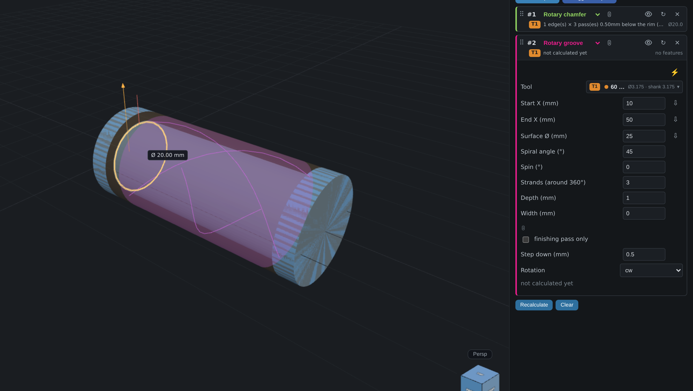
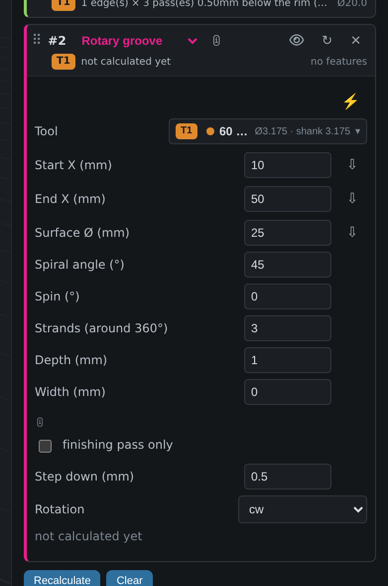
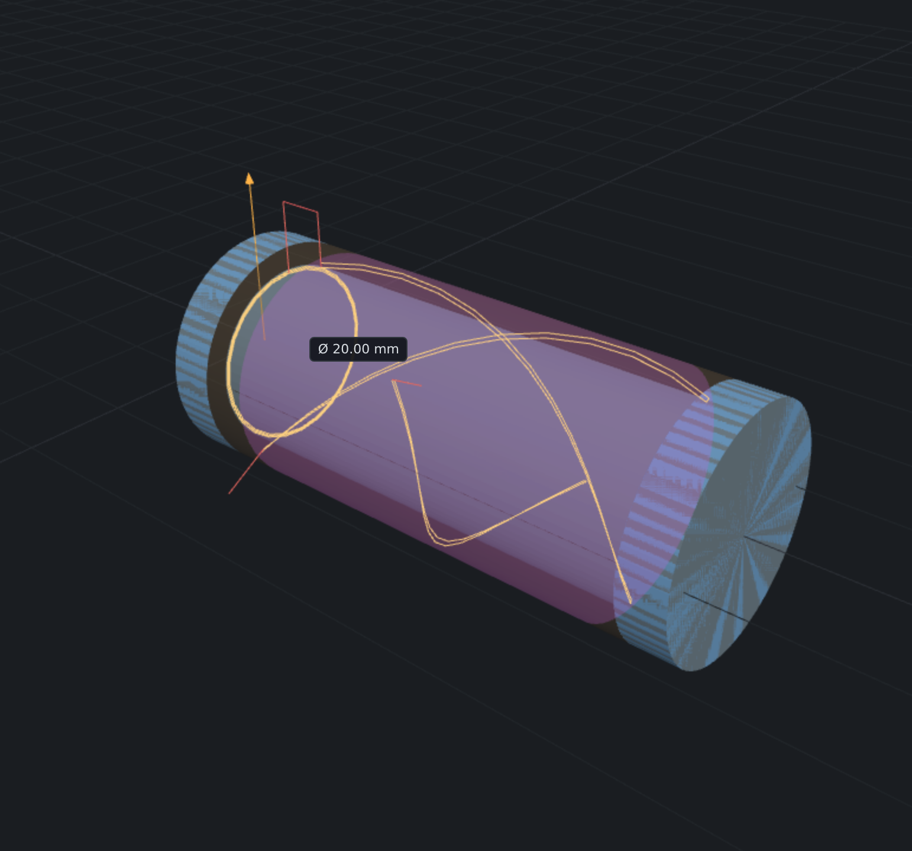

# Rotary groove

Cuts helical grooves around the stock — the spiral on a twist pen or a knurled grip.

*In 3D printing terms:* vase mode, cut into metal — one continuous spiral instead of discrete passes, wound around a spinning cylinder.

## What it is

A parametric op: you give it an X range and the groove's shape, and it cuts [helix](../glossary.md#helix) strands around the stock. The **spiral angle** sets how far off the circumferential direction the strands lean — 90° gives straight axial lines, low angles give shallow spirals, and anything between gives the twist. **Strands** cuts several grooves, evenly spaced around 360°.

The depth is a ladder that re-traces the *same* groove at every level — never a mirrored one. Sweeps alternate direction and A returns along the helix, so the tool re-enters its own track instead of crossing fresh material sideways. **Width** fans parallel passes when you want a groove wider than the tool; 0 follows the lines, and a [V-bit](../glossary.md#v-bit) then knurls — the groove width comes from the depth and the bit's angle.

Every X+A sweep runs in [G93](../glossary.md#g93) inverse-time; the plunges between levels run plain G94. The groove deliberately runs past the end faces — no 360° closing rings at the ends.

## When you'd use it

- A twist pen or a knurled grip — the classic decorative spirals.
- Straight flutes on a handle: spiral angle 90°, several strands.
- A cable-relief spiral along a rod.
- Grip texture anywhere a round part wants finger purchase.

## How to use it

1. **Add the op.** Set the stock to 4-axis mode first. `+ Add toolpath`, then set the kind select to **Rotary groove** and pick the tool.

2. **Set the span.** **Start X** and **End X** bound the groove, each with a ⇩ pick from a feature. **Surface Ø** is the outer diameter being carved — blank means the stock surface; set it (or pick it) after a facing or turning pass so the tool starts at the real surface instead of air above a turned-down section.

<!-- CAPTURE: 4-axis cylinder stock (Ø25 x 60 mm), a Rotary groove op
     added via + Add toolpath with the kind select switched to Rotary
     groove, row expanded showing Start X 10 / End X 50, Surface Ø
     blank, the viewport showing the op's setup ghost and groove
     marks on the stock (the real preview-adjacent decoration the op
     draws). Framing: loose crop of the Ops panel row plus viewport
     context. Shot at deviceScaleFactor 2. -->

*Figure 1 — No features to pick: the groove is parametric, wound over whatever X span you give it.*

3. **Shape the groove.** **Spiral angle** (0.1–90°), **Spin** (where strand 1 starts around the cylinder — it stacks additively with the [index](index.md) datum), **Strands**, **Depth**, **Width**. Width 0 follows the lines; width wider than the tool fans parallel passes. **Step down** splits deep grooves into levels; **Rotation** picks cw or ccw.

<!-- CAPTURE: the same Rotary groove op, panel expanded: Spiral angle
     45, Spin 0, Strands 3, Depth 1, Width 0, Rotation cw, Step down
     at its default, finishing pass only unticked, op not yet
     calculated. Framing: crop of the Ops panel around the rotary
     groove row, a little margin around it. Shot at deviceScaleFactor
     2. -->

*Figure 2 — Width 0 with a V-bit is knurling: the groove is exactly what the bit carves at that depth.*

4. **Recalculate.** The preview draws the wound strands in amber, [rapids](../glossary.md#rapids) red. The time estimate is honest about the rotary ceiling — X+A sweeps are G93-timed and long spirals take real minutes.

<!-- CAPTURE: the same job after Recalculate — toolpath preview on in
     the viewport, three amber helical strands wound around the
     cylinder over the X span (rapids red); the op row summary with
     its real strand/pass/minute figures. Framing: loose crop of the
     viewport with the wound strands. Shot at deviceScaleFactor 2. -->

*Figure 3 — Read the strands: same angle, same depth, evenly spaced — the preview is the finished grip.*

5. **The gotcha.** A width narrower than the tool doesn't exist. The panel warns: "a N.Nmm tool can't follow a N.Nmm line — the groove comes out ~N.Nmm wide. Set 0 if you mean to just follow the lines". A wider tool always wins.

## Tips & pitfalls

- **Set Surface Ø after turning.** A groove planned from the stock Ø but cut on a faced-down section starts each pass in air. Pick the faced surface's Ø — the ⇩ takes it from a rim.
- **Strands and angle are independent.** Angle sets each strand's lean; strands set how many. A knurl is many strands at a shallow angle; a twist pen is one or two at a steeper one.
- **Deep grooves climb down their own track.** The ladder retraces the same groove per level, so depth beyond the tool's reach is a step-down question, not a side-load one — see [Step over and step down](../concepts/step-over-and-step-down.md).
