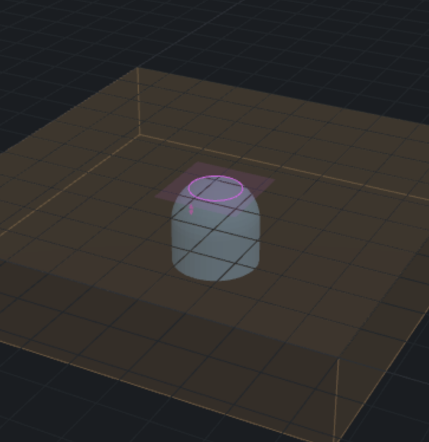
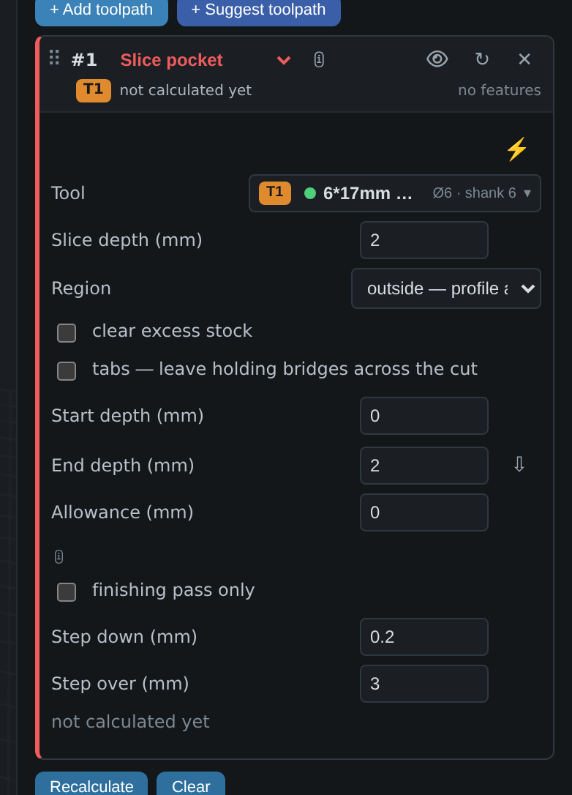
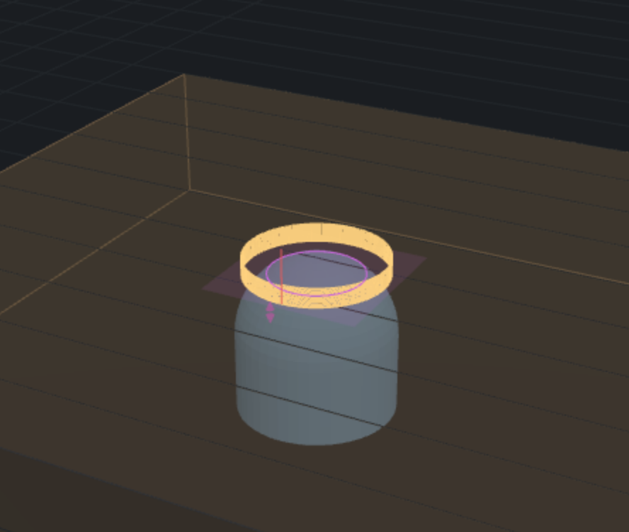

# Slice pocket

Slices the model at one height and machines that cross-section — one clean shape that roughs a complicated body.

*In 3D printing terms:* your slicer already cuts a model into layers. This takes one of those layers and machines it: the cross-section at that height becomes the cut region.

## What it is

Slice pocket asks for no selection. It slices the loaded model at one height — Slice depth, measured down from the stock's [crown](../glossary.md#crown) — and takes the cross-section there. **Region** then picks what happens to that shape: **inside** [pockets](../ops/pocket.md) the section's interior; **outside** [profiles](../ops/profile.md) around it, leaving the body standing.

Either way, the cut runs over a depth band — [Start depth and End depth](../reference/fields.md#depths), measured from the crown like every op — and that band can sit far below the slice itself. The band repeats the one section down its whole depth; it doesn't follow the model's shape.

The violet plane in the viewport is the slice. Drag its handle up or down and the section re-draws live.

## When you'd use it

- Roughing a rounded or organic body that would take a dozen picked faces to [pocket](../ops/pocket.md) by hand.
- Cutting a part free from the stock: Region **outside**, with [tabs](../glossary.md#tabs) holding it in place.
- Sweeping the waste between a section and the stock walls out to the edge, in the same pass.
- A first rough with a simple, predictable shape, ahead of a finishing op.
- Cutting on the side of a part in 4-axis mode — freeze the stock with an [Index](../glossary.md#indexing) op first, and the slice cuts the rotated face.

## How to use it

1. **Add the op.** `+ Add toolpath` appends an op with the last-used tool — a Pocket by default. On the new row, set the kind dropdown to **Slice pocket**: the fields reset to Slice-pocket defaults. The op needs a loaded model — the slice comes from it (see [The Model tab](../the-app/model-tab.md#loading-a-model)).

2. **Set the slice height.** Slice depth is millimetres below the crown, 2 mm by default. Drag the violet plane in the viewport, or type in the box — the section outline draws on the plane as you move it.

<!-- CAPTURE: demo model loaded with a clean vertical body at mid-height
     (e.g. a dome-topped boss on the default 100 x 100 x 20 stock, dome
     above the slice so the section is a clean shape), slice-pocket op
     added (+ Add toolpath, then the row's kind dropdown set to Slice
     pocket) and its row EXPANDED — the violet
     translucent slice plane crosses the model 2 mm below the crown,
     the section outline drawn on it in the same violet, and the drag
     handle (two small stacked arrows) on the plane's near edge. No
     selection highlights — this op selects nothing. Framing: loose
     crop of the viewport around the model and plane. deviceScaleFactor 2 -->

*Figure 1 — The plane sits where Slice depth puts it; dragging the handle moves the plane and updates the box live.*

3. **Set the fields that matter.** Region is a dropdown — "outside — profile around the section, leave it standing" or "inside — pocket the section interior". The ⇩ button next to End depth takes that measurement straight from a picked face. [Allowance](../glossary.md#allowance) defaults to 0 — raising it leaves a skin for a finishing pass, outside the ring in outside mode, on the interior walls and floor in inside mode (see [Allowances](../concepts/allowances.md)). [Step down](../glossary.md#step-down) comes from the tool's preset; [step-over](../glossary.md#step-over) defaults to half the tool's diameter.

   Region **outside** adds two controls: **clear excess stock** sweeps the waste between the section and the stock wall out to the edge, and **tabs** leaves holding bridges across the ring for a cut-out — [Tabs](../reference/fields.md#tabs).

<!-- CAPTURE: the same slice-pocket op, panel expanded: tool T1 (Ø6
     flat), Slice depth 2, Region showing "outside — profile around
     the section, leave it standing" (the closed native dropdown row),
     clear excess stock unticked, tabs unticked, Start depth 0, End
     depth 2, Allowance 0, finishing pass only unticked, Step down 0.2
     and Step over 3 at their defaults, op not yet calculated ("not
     calculated yet" on the row). Framing: crop of the Ops panel
     around the slice-pocket row, a little margin around it.
     deviceScaleFactor 2 -->

*Figure 2 — Region outside adds clear excess stock and tabs; switch to inside and both rows disappear.*

4. **Recalculate.** The panel's Recalculate button generates the [toolpath](../glossary.md#toolpath) and turns the preview on. Outside mode draws the ring riding the section outline, offset out by the tool radius; inside mode fills the section the way Pocket does.

<!-- CAPTURE: the same job after Recalculate with Region outside and
     clear excess stock off — toolpath preview on in the viewport, the
     amber profile ring riding the section outline (offset out by the
     tool radius, so it sits just outside the violet section line),
     rapids red; the op row summary reads "1 passes around the section
     2.0 below the crown (profile), z20.0 → z18.0, ~M min" ("passes"
     counts concentric rings; minutes as generated). Framing: loose
     crop of the viewport with the ring and the model visible.
     deviceScaleFactor 2 -->

*Figure 3 — The ring sits outside the section by the tool radius, so the body inside keeps its modelled size.*

5. **The gotcha.** Generation fails with "the section plane at this slice depth is empty — move it (the viewport handle or the Slice depth box) to where the model has a clean body" when the plane sits above the body or through a gap in it. Lower or raise the plane until the section is real.

## Tips & pitfalls

- **Pick a height where the body is clean** — away from rounded or chamfered tops. The cut band repeats that one section down its whole depth, so a section taken at a shoulder misrepresents everything below it. For a rough that follows the model's surface, Waterline Contour slices at many heights instead.
- **Read the summary for dropped chains.** "N open chain(s) dropped — slice incomplete" means the mesh has a gap at that height and part of the section is missing. Move the plane, or fix the model.
- **The outside ring may cross the stock edge** — that's deliberate, so the tool gets a clean exit on a tight stock. With **clear excess stock** on, the waste between the section and the wall is swept out too; if that frame is thinner than the tool, the waste stays standing and the summary says so.
- **Tabs work in outside mode only** — an inside pocket can't free the part, so the tab rows hide there. See [Tabs](../concepts/tabs.md) for how the bridges are placed and snapped off.
