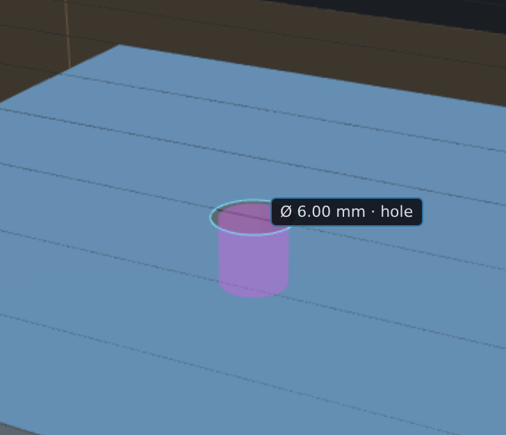
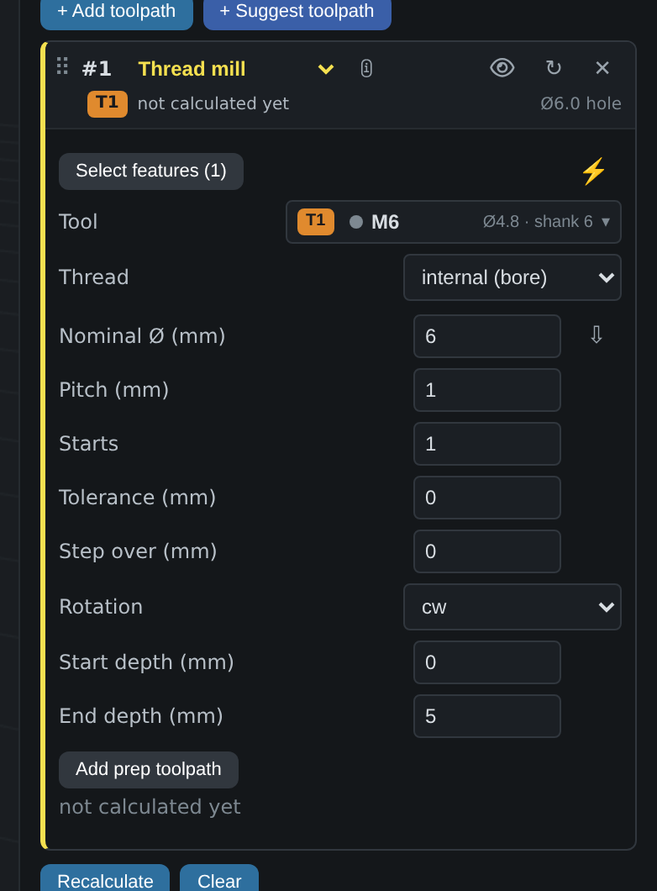
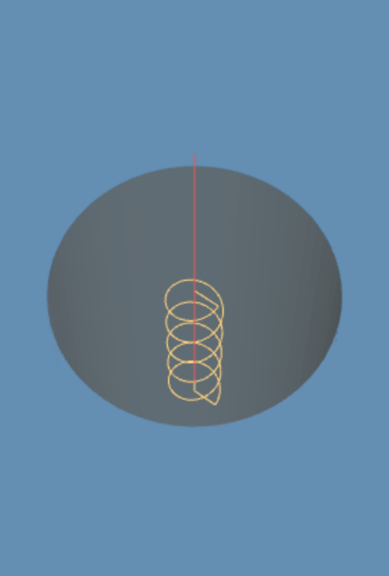

# Thread mill

Cuts a screw thread by milling — inside a bore or around a boss, where a tap would snap or can't reach at all.

## What it is

A **thread mill** is a small cutter whose edge carries the thread's whole profile. The op plunges it to the thread's bottom, feeds it radially to depth, then climbs one spiral back to the top. Every revolution it rises exactly one **pitch** — the distance from one crest to the next — so the groove it carves is a true helix. The cut runs in machine X/Y/Z, no rotary axis. Vertical threads cut fine in plain 3-axis jobs.

The same op does internal (bore) and external (boss) threads — pick which with the Thread field. The fit is radial: the tool's full profile cuts the groove in one shape, so there's no separate thread-depth knob, just the fit itself.

## When you'd use it

- Threads in tough material — a tap snaps the moment it bites, the mill just takes another pass.
- Internal threads where a tap's torque and trapped swarf worry you.
- External threads on a [boss](../glossary.md#boss) — a tap can't cut those at all.
- Many sizes from one tool: the single-tooth mills in the library cut any pitch.
- A thread the app has already measured on a CAD model — see below.
- Cutting on the side of a part in 4-axis mode — freeze the stock with an [Index](../glossary.md#indexing) op, then thread the rotated face.

## How to use it

1. **Add the op.** `+ Add toolpath`, then set the kind select to **Thread mill**. Generation refuses anything but a thread mill — pick one from the Threadmill family in the [tool library](../concepts/tools-and-materials.md).

2. **Point it at the bore or boss.** Click `Select features` on the op row, then click in the viewport (the flow is the same as [Pocket](pocket.md)'s). Three clicks all work: the rim circle at the thread's mouth, the cylinder wall itself, or the flat face around the rim. One op cuts one diameter and one kind — a mixed selection is refused, so split those across two ops.

<!-- CAPTURE: demo part is a 60 x 60 x 15 mm block with a centered
     vertical Ø6 through-bore, sitting on the default 100 x 100 x 20
     stock, block top flush with the crown. Thread mill op added via
     + Add toolpath, row expanded, Select features armed, the bore's
     rim circle clicked and highlighted — the op row shows
     "Select features (1)". Framing: loose crop of the viewport area
     with the highlighted rim — not the whole window.
     deviceScaleFactor 2 -->

*Figure 1 — Clicking the rim attaches the bore; clicking the wall or the face around it lands on the same thread.*

3. **Set the fields that matter.** The ⇩ button next to **Nominal Ø** pre-fills the diameter, the pitch, inside/outside, and both depths from the picked rim or wall. [Start depth](../reference/fields.md#depths) and End depth bracket the thread, measured down from the stock's [crown](../glossary.md#crown). **Tolerance** deepens the grooves for a looser fit. The app applies it outward on a bore and inward on a boss, so the box stays zero or positive. **Starts** cuts several parallel grooves — a two-start nut travels twice as far per turn. **Rotation** names the hand: cw is right-hand, ccw is left-hand.

   **Pitch** greys out when the selected mill is multi-tooth — its teeth only line up at the recorded pitch. The Makera mills in the library are all single-tooth, so their pitch stays editable and defaults to the tool's own value.

<!-- CAPTURE: the same Thread mill op, panel expanded: tool Carvera
     M6 Threadmill, Thread "internal (bore)", Nominal Ø 6 with the ⇩
     link active from the picked rim, Pitch 1.0, Starts 1,
     Tolerance 0, Step over 0, Rotation cw, Start depth 0,
     End depth 5 (the ⇩ prefill), Add prep toolpath button visible
     below the depth fields. Framing: crop of the Ops panel around
     the thread mill row, a little margin around it.
     deviceScaleFactor 2 -->

*Figure 2 — Single-tooth mill: pitch stays editable. A multi-tooth mill would grey the box and lock its own pitch in.*

4. **Recalculate.** The [toolpath](../glossary.md#toolpath) preview shows the helix climbing the bore or the boss, cutting moves amber and [rapids](../glossary.md#rapids) red. The ⚡ popup holds feed, plunge and clearance, defaulted from the tool's preset for the stock material — see [Feeds and speeds](../concepts/feeds-and-speeds.md).

<!-- CAPTURE: the same job after Recalculate — toolpath preview on in
     the viewport, the amber helix climbing the inside of the Ø6 bore
     (rapids red), viewed from slightly above the bore mouth; the op
     row reads "1 internal thread(s), 6×1, ~X min" (time as
     generated). Framing: loose crop of the viewport with the preview.
     deviceScaleFactor 2 -->

*Figure 3 — One unbroken amber spiral from the thread's bottom to its top; the pass runs twice — the second lap is the spring pass.*

5. **The gotcha: prep the blank first.** The mill cuts the thread's form only — the material around it must already be the right size. Inside, the bore needs drilling to the minor Ø first (about nominal − 1.08 × pitch — a [Drill](drill.md) op). Outside, the boss needs turning to the major Ø (a Profile op). **Add prep toolpath** inserts the right prefilled op — a Pocket or a Profile — directly before this one, with its own tool and feeds.

## Tips & pitfalls

- **Tolerance is your fit knob.** Raising it deepens the grooves — a looser-running fit — without touching the thread's diameter or depth numbers. Start at 0, test the nut, adjust.
- **[Step over](../glossary.md#step-over) splits the form for tough material.** 0 (the default) cuts the full profile in one radial pass. Set around 0.2–0.3 mm and the op works down in even radial steps, each level a full bottom-up thread, deepest last.
- **Caution: deep threads are refused, not fudged.** External threads longer than the mill's cutting length fail generation — above it the shank would grind the stock beside the thread. Any thread beyond the tool's reach (overall length minus about 15 mm of collet) fails too. Split the thread into bands or pick a longer mill.
- **Tight bores exit along the spiral.** When a bore leaves under 0.2 mm of room beside the tool, the exit keeps helixing past the face instead of lifting straight out — one extra lap of air, and it saves the thread teeth from a dragged tool.
