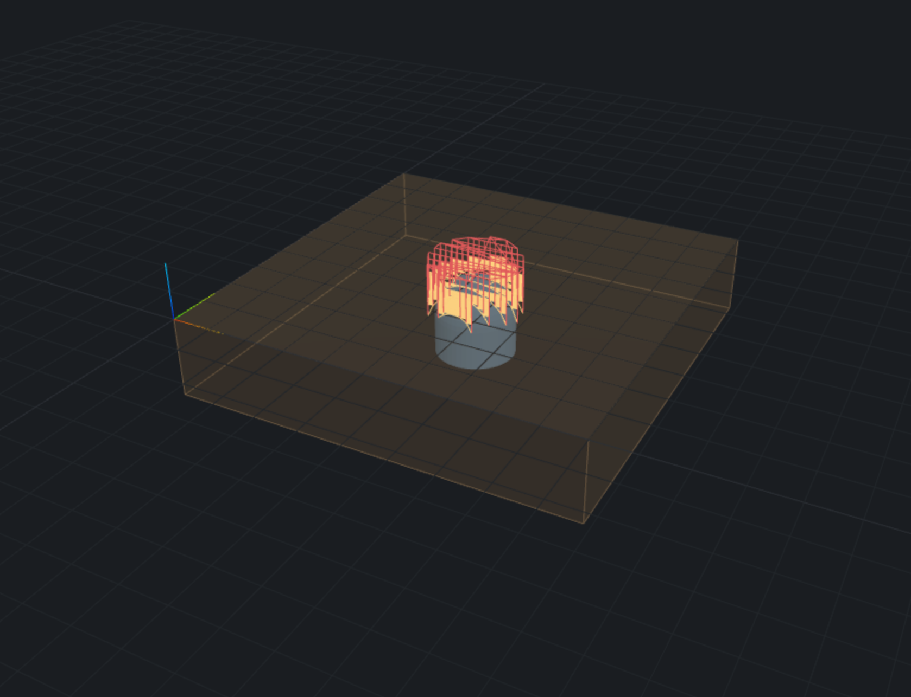
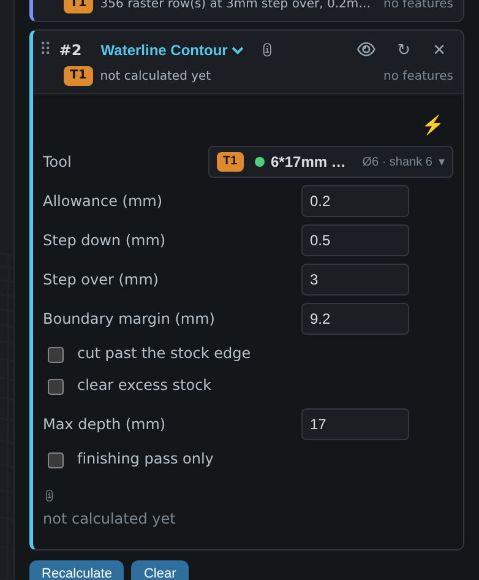
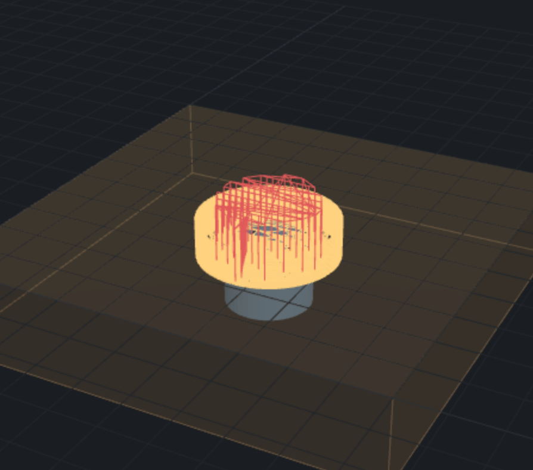

# Waterline Contour

Roughs the whole model in flat slices — one constant-height level at a time, from the stock's [crown](../glossary.md#crown) down to the model's floor.

*In 3D printing terms:* your printer builds a model one layer at a time. Waterline removes one the same way — each level machines a flat slice, and the model emerges from the stack of layers, cut in reverse.

## What it is

Waterline asks for no selection and has no depth boxes. The whole loaded model is the target: the op slices it at fixed heights, and at each level clears everything a vertical tool can reach around the model's cross-section.

Two stops bound every level, and both matter:

- **The upper shadow.** Everything at or above the level — overhangs included — casts a keep-out the tool may not enter. The tool only ever cuts down to the highest material in each vertical column, so it never goes underneath an overhang.
- **The widest section.** Below the model's widest point, a level would only clear the ring of waste around the part — the clearance band the cut-out [profile](profile.md) rides in. The ladder stops there. Cutting the part free is the profile op's job.

[Allowance](../glossary.md#allowance) leaves stock on all sides — walls and floor — for the finishing op. The default 0.2 mm suits a follow-up [Raster Contour](raster-contour.md) at allowance 0, which cuts to the surface (see [Allowances](../concepts/allowances.md)).

## When you'd use it

- Roughing an organic or free-form model that would take a dozen picked faces to [pocket](pocket.md) by hand.
- Ahead of a [Raster Contour](raster-contour.md) finish — this pair is the standard rough-then-finish workflow for 3D shapes.
- Roughing a tall part from several sides in 4-axis mode (see below).
- Clearing waste right out to the stock edge, so no shelf of uncleared material survives outside the model (with **clear excess stock** on).
- A relief coin: rough the carved face, then [profile](profile.md) the coin out of the stock.

## How to use it

1. **Add the op.** `+ Add toolpath` appends an op with the last-used tool; set the kind dropdown to **Waterline Contour**. The op needs a loaded model — the slices come from it.

2. **Point it at what it cuts.** There's nothing to select: the loaded model is the target, and the levels run from the stock crown down to the model's floor (never below the stock bottom — the holder underneath stays intact).

<!-- CAPTURE: a loaded organic demo model on the default stock (a dome or
     sphere sitting on top of the stock, so the waterline levels have
     body to wrap), waterline op added (+ Add toolpath, then the row's
     kind dropdown set to Waterline Contour) with its row EXPANDED. No
     selection highlights and no slice plane — this op selects nothing
     and has no depth boxes; the loaded model itself is the point.
     Framing: loose crop of the viewport around the model and stock.
     deviceScaleFactor 2 -->

*Figure 1 — No selection here: the whole loaded model is what gets roughed.*

3. **Set the fields that matter.** [Allowance](../glossary.md#allowance) defaults to 0.2 mm. [Step down](../glossary.md#step-down) comes from your material's preset — see [Feeds and speeds](../concepts/feeds-and-speeds.md) — floored at 0.5 mm; [step-over](../glossary.md#step-over) defaults to half the tool's diameter (see [Step-over and step-down](../concepts/step-over-and-step-down.md)). **Max depth** pre-fills from the tool's [flute](../glossary.md#flutes) length: cut deeper than the flute and the shaft and [collet](../glossary.md#collet) ride into standing stock. Override it when you know the shape keeps the shaft clear — the simulation's red marks check that claim. The shared field semantics live in [Fields reference](../reference/fields.md).

<!-- CAPTURE: the same waterline op, panel expanded: tool T1 (Ø6 flat),
     Allowance 0.2, Step down at the demo material's preset value
     floored at 0.5 (capture the number the demo shows), Step over 3
     (half of Ø6), Boundary margin showing the derived value (tool Ø +
     allowance + step over = 9.2 for the Ø6 demo tool), cut past the
     stock edge unticked, clear excess stock unticked, Max depth
     pre-filled from the demo tool's flute length (capture the number
     the demo shows), finishing pass only unticked, op not yet
     calculated ("not calculated yet" on the row). Framing: crop of
     the Ops panel around the waterline row, a little margin around
     it. deviceScaleFactor 2 -->

*Figure 2 — Boundary margin shows the derived value (tool Ø + allowance + step over) until you type your own.*

   Three checkboxes sit below the numbers. **Cut past the stock edge** lets the boundary pass run outside the declared [stock](../glossary.md#stock) instead of pinching off at its edge. **Clear excess stock** makes every level sweep the waste out to the stock edge as it descends — essential in 4-axis, where a leftover shelf can bottom out the collet. **Finishing pass only** skips the roughing ladder and scrubs only where the tool touches the model; ticking it zeroes the allowance.

4. **Recalculate.** The panel generates the [toolpath](../glossary.md#toolpath) and turns the preview on: banded rings stepping down the model, one flat slice per level. The row summary reports the level count, pass count and time estimate.

<!-- CAPTURE: the same job after Recalculate — toolpath preview on in
     the viewport, the banded waterline rough visible: constant-Z
     clearing levels stepping down around the dome, the upper-shadow
     keep-out leaving the model's body standing, the clearance ring
     around it, rapids red. The op row summary reads "N waterline
     level(s), M passes, z0.0 → z-K.K, 0.2mm allowance, ~T min"
     (capture the exact numbers the demo shows). Framing: loose crop
     of the viewport with the banded toolpath and the model visible.
     deviceScaleFactor 2 -->

*Figure 3 — Each band is one flat level; the model's body stands untouched inside its keep-out shadow.*

5. **The gotcha.** A ladder deeper than the max depth stops short on purpose, and the summary says so: "max depth N mm: ladder stops at z… — floor left standing". That's the flute limit protecting your tool. Raise Max depth only if a longer flute (or a shape that keeps the shaft clear) allows it.

## Tips & pitfalls

- **No tabs — by design.** Waterline carries no tab fields because it provably can't free the part: the upper-shadow keep-out plus the widest-section stop mean the rough never severs the model from the stock. Cut the part out afterwards with a [profile](profile.md) op, [tabs](../glossary.md#tabs) and all — see [Tabs](../concepts/tabs.md).
- **The "ladder stopped" note is normal.** "Levels below only clear the moat" means the rough reached the model's widest section; everything below is the profile op's territory.
- **Undercuts warn, not silently mis-cut.** A band whose section widens upward can't be reached by a vertical tool in 3-axis mode — the summary warns "3-axis roughing cannot reach under overhangs". Check the preview and plan a re-fixture or a 4-axis pass.
- **Keep step-down above the allowance.** A step-down at or below the allowance leaves each level with no band to clear; those levels are skipped and the summary says so. The 0.5 mm floor exists to prevent exactly this against the 0.2 mm default.

## Roughing around a part: the 4th axis

Waterline also runs inside an indexed 4-axis job: put an [Index](../glossary.md#indexing) op above it and the ladder cuts the rotated face, bounded by the model's floor and widest section *in that orientation*. Stack pairs — Waterline Contour, Index, Waterline Contour, Index… — to rough around a tall part one face at a time. Each rough is bounded by its own orientation's geometry, so the stack can never free the part either. See [The 4th axis](../concepts/the-4th-axis.md) for how indexing works.
