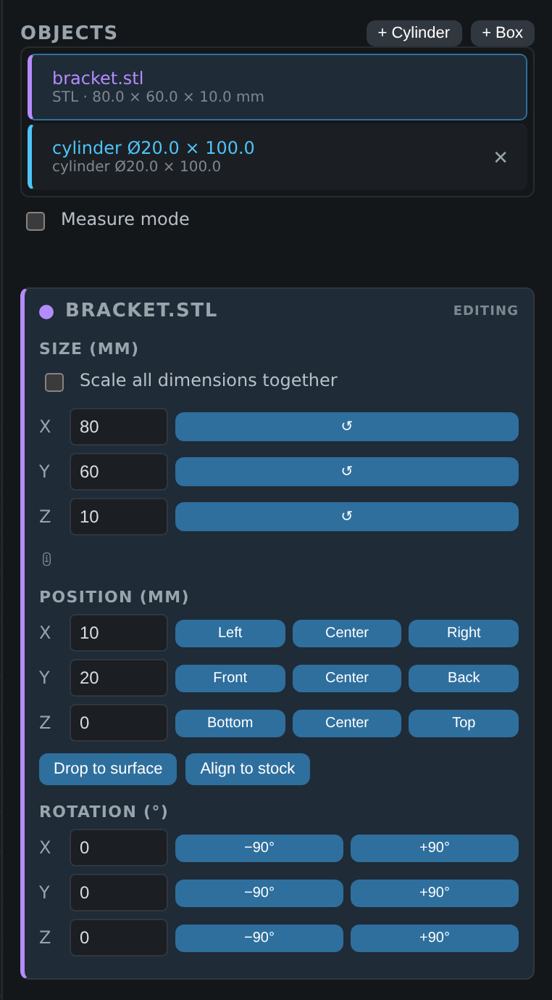
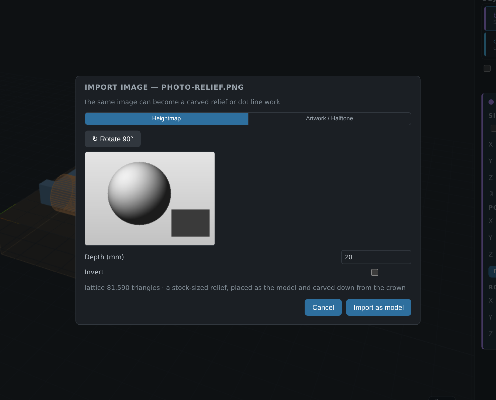
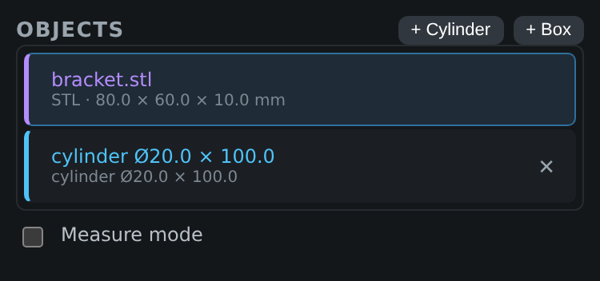
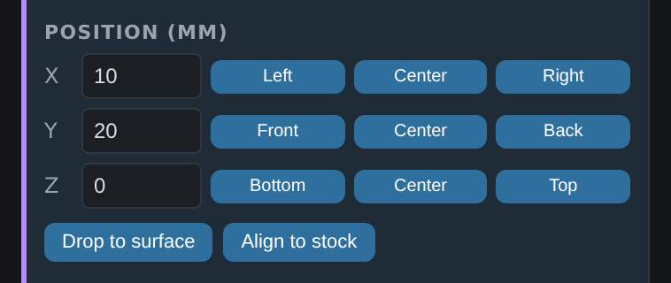
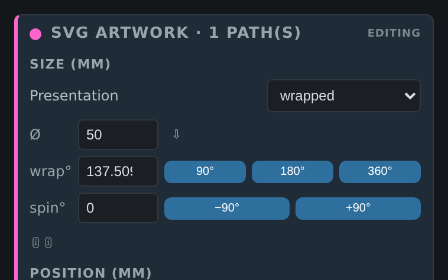

# The Model tab

Everything the job cuts from lives here: the model you loaded, built-in shapes, and imported artwork.

## The layout

The tab has two sections. The **Objects** list names every cuttable thing in the job — the model, any shapes you added, any artwork. Below it, the **editor card** appears when you select one, with its Size, Position, and Rotation.

You don't load files from this tab. Drop a file anywhere on the viewport and the app switches here for you.

<!-- CAPTURE: Model tab active. A binary STL loaded (an 80 x 60 x 10 mm
     bracket), its row selected so the editor card shows; + Cylinder
     clicked once so the list shows both a model row and a primitive
     row. Editor card: Size (mm) with "Scale all dimensions together"
     unticked, Position (mm) with the nine snap buttons, Rotation (°).
     Stock: the default 100 x 100 x 20 box. Framing: the whole Model
     panel — Objects section plus editor card — not the whole window;
     this is the orientation figure. Shots at deviceScaleFactor 2 -->

*Figure 1 — The list is what ops can cut; the card edits one object at a time.*

## Loading a model

Drop an `.stl` or `.step` file on the viewport. The status strip confirms with the size, and the model row shows the file name, its type, and the size after scaling. A STEP is tessellated into a triangle mesh on import, and the job saves that mesh — so a saved job cuts exactly the shape you saw.

Other drops land here too. An SVG or DXF becomes an artwork in the list. A PNG or JPEG opens a choice: **Heightmap** builds a relief model — depth taken from the image's brightness — while **Artwork / Halftone** screens the image into dot line work for [engraving](../glossary.md#engraving).

<!-- CAPTURE: a PNG (a photo with clear light/dark shading) dropped on
     the viewport — the bitmap-import dialogue open with its two tabs,
     Heightmap active, its Depth field at the default (the stock
     thickness for box stock), preview showing the greyscale.
     Framing: crop around the dialogue with the viewport visible
     behind it. Shots at deviceScaleFactor 2 -->

*Figure 2 — One image, two destinations: a carved relief model, or dot line work for the engrave pipeline.*

## What the app detected

Loading a model runs feature detection: the app finds flat faces and circles on the mesh. Operations don't cut the whole model blindly — they pick these features. Tick **Features** in the Layers dropdown at the top of the viewport to see them highlighted. How ops pick them: [Pocket](../ops/pocket.md).

Fine meshes — scans and coin art, over 100,000 triangles — are detected on a simplified copy. The ⓘ on the model row says when that happened, and by how much. Display and cutting always use the full mesh.

## The objects list

- **+ Cylinder** adds a cylinder sized from the [stock](../glossary.md#stock): its Ø takes the stock's (or the stock's smaller cross-section for box stock), its length the stock's X span.
- **+ Box** adds a 10 × 10 × 5 mm box sitting on the stock top, centered.
- Each row's second line describes the object — `STL · 80.0 × 60.0 × 10.0 mm` for the model, `cylinder Ø25.0 × 100.0` for a cylinder, the artwork's name and size for artwork.
- **✕** removes a primitive. The model row has no ✕ — a new drop or New Job replaces it.
- **Measure mode** — hover highlights, a click selects; two clicks read as a distance, right-click clears.

<!-- CAPTURE: same job as figure 1. Framing: tight crop of the Objects
     section — the head with + Cylinder / + Box, the model row
     (bracket.stl, "STL · 80.0 x 60.0 x 10.0 mm"), the cylinder row
     with its ✕, and the Measure mode checkbox. Shots at
     deviceScaleFactor 2 -->

*Figure 3 — The cylinder sized itself to the stock on arrival; everything after that is yours to edit.*

## The editor card

Select anything in the list and the card edits it. The header names the object; a colored dot and bar match the row's type.

**Size.** The model shows X/Y/Z as its current displayed size — type a number and the app rescales to hit it. **Scale all dimensions together** keeps proportions while you do. The ↺ button reverts that axis to the imported size; the ⓘ shows the scale factors. Cylinders get **Ø** and **L**, boxes X/Y/Z, same revert. Flat artwork shows **W** and **H** — both drive the same single scale, so artwork never shears. ↺ returns it to its imported size (DXF imports in mm; SVG user units read as 1 mm).

**Position.** X/Y/Z numbers, plus three snap buttons per axis: Left/Center/Right, Front/Center/Back, Bottom/Center/Top. Each aligns that edge or middle of the object with the stock's — rotation included, so a tilted part still lands flush. **Drop to surface** rests the object on the stock's top. **Align to stock** centers it in the stock — on the rotation axis for cylinder work.

<!-- CAPTURE: model selected as in figure 1. Framing: crop of the
     editor card's Position (mm) section — the X/Y/Z rows with their
     Left/Center/Right, Front/Center/Back, Bottom/Center/Top buttons —
     plus the Drop to surface / Align to stock button pair below.
     Shots at deviceScaleFactor 2 -->

*Figure 4 — The snap buttons work from the object's rotated bounds, so they stay honest after you rotate the part.*

**Rotation.** X/Y/Z degrees with −90°/+90° nudge buttons.

## Wrapped artwork

An artwork's **Presentation** switches between `flat` and `wrapped`. Wrapped bends the artwork around a cylinder for [A axis](../glossary.md#a-axis) work:

- **Ø** — the diameter the artwork wraps onto: the cutting surface, not the raw stock. The ⇩ button arms a pick — click a circular feature in the viewport (the faced rim of rotary stock, say) and it becomes the Ø. The pick semantics are the same as the depth fields': [Fields every operation shares](../reference/fields.md#depths).
- **wrap°** — how far around the cylinder the artwork spans. The 90° / 180° / 360° buttons set the common spans.
- **spin°** — where the artwork sits around the cylinder. Keep it clear of ±180°, the seam where the wrap closes.

A freshly imported artwork places itself: flat on the stock's [crown](../glossary.md#crown), or wrapped around the stock cylinder in 4-axis mode at 1 mm per artwork unit, clamped to a single turn.

<!-- CAPTURE: 4-axis cylinder stock (e.g. Ø50 x 100 mm), an SVG dropped
     on the viewport so it imports wrapped; the artwork row selected.
     Framing: crop of the editor card — the Presentation select on
     "wrapped", the Ø row with its ⇩ button, the wrap° row with the
     90°/180°/360° quick-sets, and the spin° row with −90°/+90°.
     Shots at deviceScaleFactor 2 -->

*Figure 5 — Changing Ø keeps the angular span and re-derives the millimeters per unit, so the artwork's picture never distorts.*

## Where next

- A first job from drop to G-code: [Your first cut](../getting-started/your-first-cut.md)
- Picking the detected features: [Pocket](../ops/pocket.md)
- Wrapped cutting in 4-axis mode: [Rotary face](../ops/rotary-face.md)
