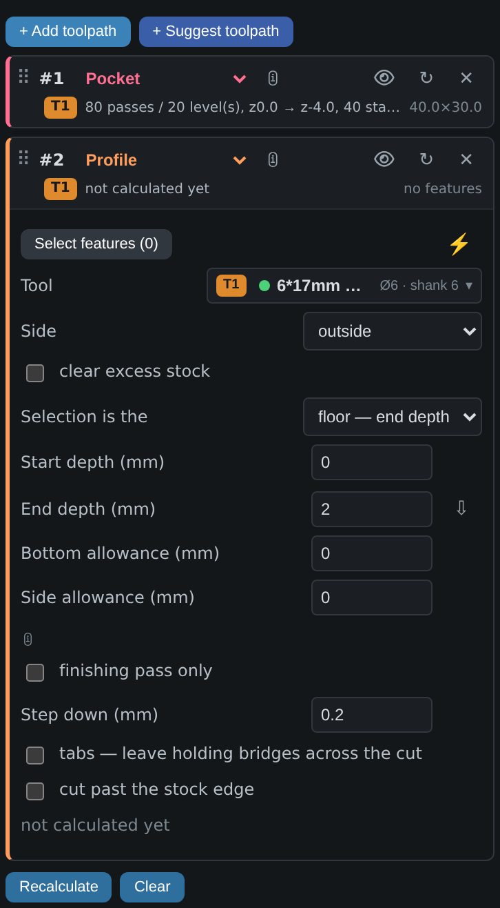
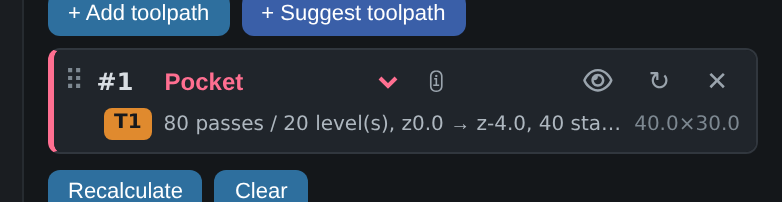
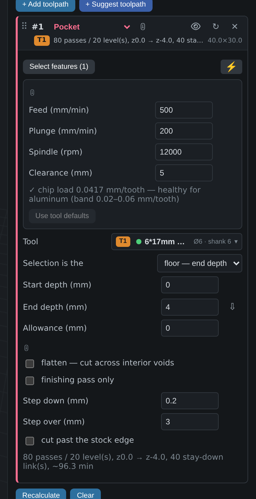

# The Ops tab

This tab is the job plan: one row per [toolpath](../glossary.md#toolpath),
and the list order is the order the machine cuts them.

## The layout

Each op is a row. The top of the panel adds ops; the bottom recalculates
them. A row starts collapsed — kind, tool chip, and a one-line summary —
and expands to that op's full settings.

<!-- CAPTURE: Ops tab with two ops — a Pocket row (calculated, collapsed:
     T1 chip, summary "80 passes / 20 level(s), z0.0 → z-4.0, ~96.3 min",
     a feature snippet) above an expanded second op (e.g. a Profile with
     its Tool picker and fields visible). + Add toolpath and
     + Suggest toolpath visible at the top, Recalculate and Clear at the
     bottom. Framing: the whole Ops panel, edge to edge -->

*Figure 1 — The row is the op; expanding it opens the settings for that op only.*

## Adding an op

`+ Add toolpath` appends a new Pocket op with the last-used tool and opens
its row. Change the kind in the row's dropdown — the fields refill with
that kind's defaults, and any features you'd already selected stay
selected.

The menu splits into flat ops and a `— 4-axis only —` section. The rotary
kinds stay grayed out until you switch to 4-axis mode on the Stock tab.

**Tip:** not sure which kind fits? `+ Suggest toolpath` arms a picker:
click a feature in the viewport and the app tells you what it measured
and which ops could cut it.

## The op row

<!-- CAPTURE: one calculated Pocket op row, collapsed: kind select
     "Pocket", ⓘ, 👁, ↻, ✕ icons; T1 tool chip; summary
     "80 passes / 20 level(s), z0.0 → z-4.0, ~96.3 min"; a feature
     snippet like "recess floor". Framing: loose crop of the Ops panel
     around that single row -->

*Figure 2 — T1 means first tool used in the list; the export uses the same numbers.*

- **`#n` and drag.** The number is the cut order. Drag a row by its grip
  ⠿ to reorder.
- **The tool chip.** `T1`, `T2`, … assigned by first use down the list.
  Two ops sharing a tool share a number; deleting an op renumbers the
  rest. The export dialog prefills from these same numbers.
- **The summary line.** After a recalculation it reads, for example,
  `80 passes / 20 level(s), z0.0 → z-4.0, ~96.3 min` — passes and depth
  levels, the depth band, and the cutting-time estimate. Before that it
  says `not calculated yet`. Hover the line for the full text.
- **The feature snippet.** Names what the op cuts — the first two selected
  features, then `+N more`. Empty ops read `no features`.
- **Row icons.** ⓘ opens a what-this-op-does popup (Esc closes). 👁 hides
  that toolpath from the preview — the exported G-code still includes it.
  ↻ recalculates just this op. ✕ deletes it. ⚠ on the row means
  generation failed; expand the row to read why.

## Select features

The ops that cut picked geometry — Pocket, Profile, Drill, Chamfer,
Engrave, Thread mill — get a `Select features` button on the expanded row.
Click it, then click in the viewport: the button counts your picks
(`Select features (3)`) and reads `Selecting…` while armed. Kinds without
the button take their cut from the loaded model or from ranges you type —
their pages say which. What a click attaches is on each op's page:
[Pocket](../ops/pocket.md), [Profile](../ops/profile.md),
[Rotary face](../ops/rotary-face.md).

## Expanding a row

Click anywhere on a collapsed row to open it; only one row is open at a
time. Inside: the [Tool](../reference/tool-library.md) picker, the ⚡
button, and the kind's own fields — the shared ones (depths, allowances,
the ⇩ picks) are in [Fields every operation shares](../reference/fields.md).

The panel warns in place when an op can't run: some kinds need a loaded
model, and the rotary kinds need 4-axis mode.

## The ⚡ rates popup

Each op carries its own [feed rate](../glossary.md#feed-rate), plunge,
[spindle](../glossary.md#spindle) speed, and clearance height. The ⚡ popup
shows the effective numbers — defaulted from the tool's preset for your
[stock](../glossary.md#stock) material — and any box you edit becomes a
per-op override until you press `Use tool defaults`. It also grades your
chip load and can apply a recommended feed. See
[Feeds and speeds](../concepts/feeds-and-speeds.md).

<!-- CAPTURE: a Pocket op row expanded, ⚡ popup open: Feed, Plunge,
     Spindle, Clearance boxes at tool-preset values, the chip-load verdict
     line under them, "Use tool defaults" button. Framing: loose crop
     around the expanded row with the popup open -->

*Figure 3 — An edited box overrides the tool preset for this one op only.*

## Recalculate

The Recalculate button at the panel's bottom regenerates every op and
turns the preview on. It grays out while a pass runs — heavy ops compute
in a background worker, so the app stays responsive, and a
`Generating …` note shows progress. `Clear` discards the calculated
toolpaths; the ops keep their parameters, and nothing exports until you
recalculate.

The strip along the bottom of the window reports each result:
`recalculated 3 ops`, or, when something failed,
`recalculated — 1 of 3 ops failed (the ops panel says why)`.

<!-- CAPTURE: after Recalculate on a 1-op job that succeeded — the
     bottom status strip reading "recalculated 1 op". Framing: tight
     crop of the status strip, a little margin -->

*Figure 4 — Failures point at the ops panel; expand the ⚠ row for the reason.*

The row's `~ min` figure is cutting time only. The export dialog quotes a
fuller per-op estimate — it adds rapid travel and spindle ramps.

## Where next

- [Your first cut](../getting-started/your-first-cut.md) walks the whole
  flow once. The per-op pages: [Pocket](../ops/pocket.md),
  [Profile](../ops/profile.md), [Rotary face](../ops/rotary-face.md).
- [Keyboard shortcuts](../reference/keyboard-shortcuts.md) — Esc cancels
  an armed pick or closes the ⓘ popup.
