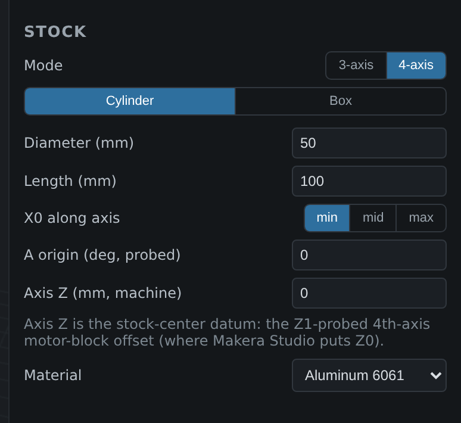
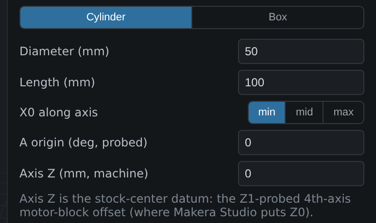
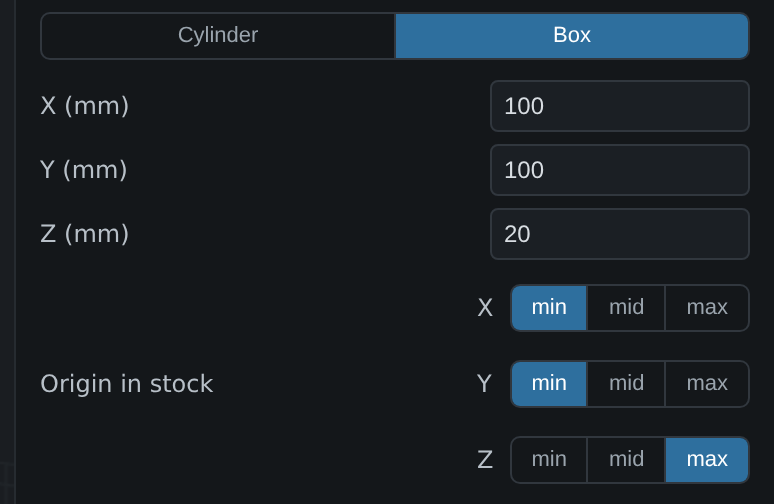
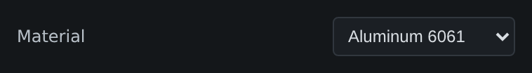

# The Stock tab

Every cut starts from a solid blank. This tab describes that blank — the
[stock](../glossary.md#stock): its shape, size, where machine zero sits on
it, and what it's made of. The app opens here.

## The layout

Four groups, top to bottom: **Mode** (3-axis or 4-axis), the shape
buttons (**Cylinder** / **Box**), the size and origin fields for the shape
you picked, and **Material**. The middle group changes with the shape and
the mode; the rest stays put.

<!-- CAPTURE: fresh job — Stock tab showing, default state: Mode on
     4-axis, Cylinder selected, Diameter (mm) 50, Length (mm) 100,
     X0 along axis on min, A origin (deg, probed) 0, Axis Z (mm,
     machine) 0, Material Aluminum 6061. Framing: the whole Stock
     panel with a little margin around it — this page's one
     whole-panel orientation shot (layout is the point). Shot at
     deviceScaleFactor 2. -->

*Figure 1 — The app opens on a Ø50 × 100 mm cylinder in 4-axis mode. First flat job? Click **Box** and the fields swap over.*

## Mode: 3-axis or 4-axis

Mode says how the blank sits in the machine — it's a machine-capability
setting, not a shape. A cylinder can sit in a vise (3-axis), and a box can
ride the rotary axis (4-axis). The 4th axis runs parallel to X: the stock
spins about X while the cutter works in Z.

The toggle changes what the Ops tab offers. The 4-axis-only operations —
Index, Rotary face, Rotary chamfer, Rotary groove, Rotary thread, Rotary
contour, 4D Contour, 4D Polish — sit greyed out until you switch to
4-axis. See [Rotary face](../ops/rotary-face.md) for a first rotary cut.

Mode also relabels the cylinder fields: in 3-axis the cylinder stands
upright and you set its **Height**; in 4-axis it lies along X and you set
its **Length**. Same blank, different pose.

## Cylinder

**Diameter (mm)** is the size across the round blank. The min/mid/max
picker puts machine zero along the axis — at one end, the middle, or the
other end. It's labeled **X0 along axis** in 4-axis and **Z0 along axis**
in 3-axis.

In 4-axis you also set two calibration numbers. Both are measured, not
guessed:

- **A origin (deg, probed)** — which angle on the stock counts as
  [A zero](../glossary.md#a-axis). Probe it; don't eyeball it.
- **Axis Z (mm, machine)** — the machine-Z height of the stock's rotation
  center. This is the Z1-probed 4th-axis motor-block offset: the same
  number Makera Studio calls Z0. It's the stock-center
  [datum](../glossary.md#datum) every rotary depth hangs from.

In 3-axis the cylinder stands vertical — axis parallel to Z, centered on
X0/Y0. Its top face is the [crown](../glossary.md#crown), the surface the
depth fields measure from; its position comes from the height and the Z0
pick.

<!-- CAPTURE: Stock tab, Cylinder selected, Mode on 4-axis (the app's
     default state): Diameter (mm) 50, Length (mm) 100, X0 along axis
     on min, then the 4-axis calibration fields — A origin (deg,
     probed) 0, Axis Z (mm, machine) 0 — and the Axis Z hint line
     visible below them. Framing: crop of the panel from the
     Cylinder/Box toggle down through the Axis Z hint, small margin.
     Shot at deviceScaleFactor 2. -->

*Figure 2 — Axis Z is a stock-center datum, not the crown: rotary depths hang from the stock's middle, not its surface.*

## Box

Three size fields — **X (mm)**, **Y (mm)**, **Z (mm)** — for the blank's
dimensions. **Origin in stock** is one min/mid/max picker per axis that
places the job's [work origin](../glossary.md#work-origin) (machine
0,0,0) inside the blank. Corners (`min`) are the usual choice — the
walkthrough sets one up that way in [Your first cut](../getting-started/your-first-cut.md).

**Tip:** In 4-axis, a box behaves as a cylinder whose diameter is the
blank's Y–Z diagonal. The corners are the widest points, so they face off
first and the flats cut air until the cutter reaches them — conservative,
never a gouge. The panel computes that diameter and shows it in the hint
line, so you can sanity-check it against your tool reach.

<!-- CAPTURE: Stock tab, Box selected, Mode on 3-axis: X (mm) 100,
     Y (mm) 100, Z (mm) 20, Origin in stock grid on min/min/max,
     Material Aluminum 6061. Framing: crop of the panel from the
     Cylinder/Box toggle down through the Origin in stock grid, small
     margin. Shot at deviceScaleFactor 2. -->

*Figure 3 — The origin pickers are where X0/Y0/Z0 land on the blank; the machine counts every cut from there.*

## Material

A dropdown of five presets: **Aluminum 6061**, **Brass 360**,
**Delrin (acetal)**, **Hardwood (maple/birch)**, and **Acrylic (cast)**.

The pick seeds the suggested feeds and depths of cut the app offers on
each op's ⚡ popup. They're starting points for a hobby-class spindle,
not rules — every op keeps its own overrides, and the
[feeds and speeds](../concepts/feeds-and-speeds.md) page explains how to
read and change them.

<!-- CAPTURE: Stock tab, Material row with Aluminum 6061 selected. The
     dropdown is a native select — its open popup can't be captured, so
     the shot shows the closed row and the caption names the five
     presets. Framing: tight crop of the Material row, small margin.
     Shot at deviceScaleFactor 2. -->

*Figure 4 — The five presets: Aluminum 6061, Brass 360, Delrin (acetal), Hardwood (maple/birch), Acrylic (cast). The material you pick here is what the ⚡ popup defaults from later.*

## Where this connects

- Every op's depth fields measure down from the stock's crown — the
  shared rules are in [Fields every operation shares](../reference/fields.md#depths).
- Set it up end to end in [Your first cut](../getting-started/your-first-cut.md).
