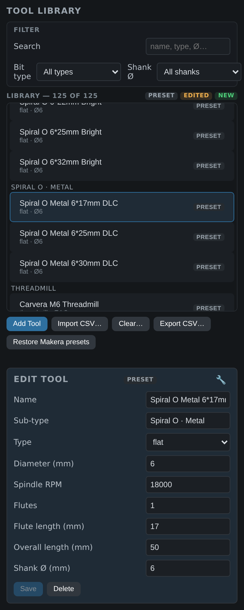
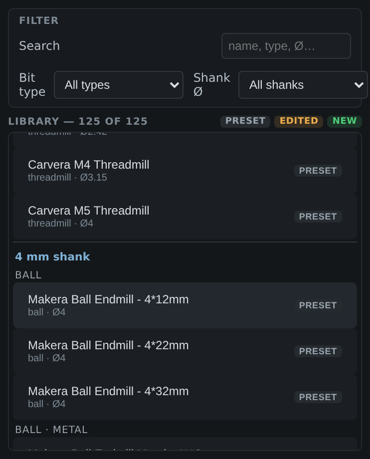
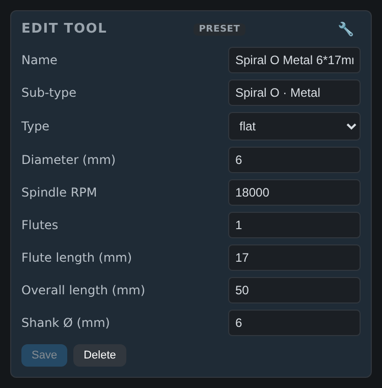
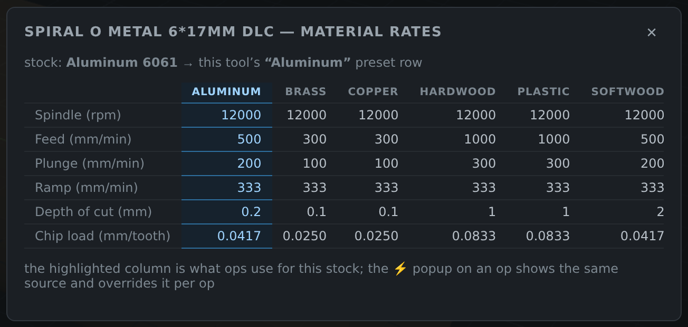
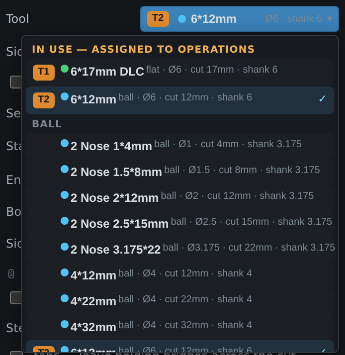
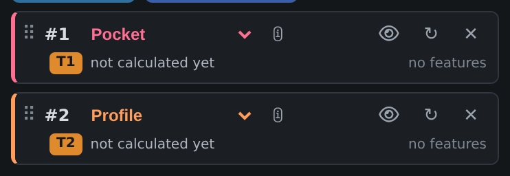

# The Tools tab

Where you tell simple.cam what cutters you actually own — the library every operation picks its tool from.

*In 3D printing terms:* this is your slicer's filament profiles, but for cutters. One entry per physical tool, carrying the measurements and the rates that suit it.

## The layout

The tab has two sections: the **library list** with its filters, and the **edit form** that appears once you select a tool. Everything here is library data, not per-job settings — enter each cutter once and every [toolpath](../glossary.md#toolpath) reuses it.

<!-- CAPTURE: the Tools tab open with the shipped Makera preset library,
     one tool selected (the Ø6 flat end mill) so both sections show —
     library list with filters and state badges on the left, Edit Tool
     form on the right. Framing: the whole Tools panel (both sections),
     not the whole window — this is the orientation figure -->

*Figure 1 — The list is the inventory; the form edits one entry at a time. Nothing here changes your job until an operation points at the tool.*

## The library list

- **Search** matches name, type, or diameter; the **Bit type** and **Shank Ø** dropdowns narrow it further.
- The list groups by [shank](../glossary.md#shank) size, then sub-type, then diameter — the same way your [collets](../glossary.md#collet) sort the bits in the drawer.
- Each row shows the tool's name, its type and Ø, and a small state badge: **preset** (an unchanged shipped Makera entry), **edited** (changed since the library was last imported, restored, or loaded), or **new** (added this session). Your own imported entries earn no badge while unchanged.

<!-- CAPTURE: library list crop — the filter row (Search, Bit type,
     Shank Ø) plus the list head with the preset/edited/new badge legend
     and a handful of rows across at least two shank groups, at least
     one badge visible. Framing: tight crop of the filter row and the
     top of the list -->

*Figure 2 — The badges compare against the library as last imported or loaded, so "edited" means edited by you, not edited by the app.*

**Add Tool** drafts a Ø6 flat [end mill](../glossary.md#end-mill) at 18000 rpm. **Import CSV…** reads Fusion 360 tool-library exports (mm tools) and asks whether to merge with your library or replace it. **Export CSV…** writes the whole library back out in the same format — worth doing once you've tuned rates. **Clear…** empties the library for a fresh import; **Restore Makera presets** brings the factory set back.

## The edit form

Select a tool and the form fills in. **Type** decides which extra fields appear — flat, ball, bull, vbit, drill, threadmill, corn, laser:

- **vbit**: Included angle and Tip diameter
- **bull**: Corner radius
- **drill**: Point angle
- **threadmill**: Pitch
- **laser**: Focus height, and its "Spindle RPM" slot becomes Power %

Every type then carries the shared measurements: **Diameter**, **Spindle RPM**, **Flutes**, **Flute length**, **Overall length**, **Shank Ø**. Measure the real cutter — a guessed [flute](../glossary.md#flutes) length makes the depth checks and the simulator lie. Each field is spelled out in [The tool library](../reference/tool-library.md).

<!-- CAPTURE: Edit Tool form for the Ø6 flat end mill, fields at their
     real values — Name, Sub-type, Type, Diameter, Spindle RPM, Flutes,
     Flute length, Overall length, Shank Ø — Save and Delete buttons
     visible. Framing: crop of the edit form section only -->

*Figure 3 — Delete refuses to remove the last tool in the library: an operation always has to have something to point at.*

**Save** commits your edits; the form stays open until you pick another tool or cancel.

## Material preset rows

A tool can carry one rate row per material — spindle speed, feed, plunge, ramp, depth of cut. The Makera presets arrive with theirs; your CSV imports bring theirs. The 🔧 button in the form header opens the tool's rates table: its preset rows next to the built-in simple.cam fallback columns, with the column generation actually reads **highlighted** — your stock material's preset row if the tool carries one, otherwise the fallback column.

<!-- CAPTURE: the 🔧 rates table popup for a Makera preset tool (e.g. the
     Ø6 flat) with stock material Aluminum 6061 — its preset rows plus
     built-in columns, the active Aluminum column highlighted, the
     "stock: Aluminum 6061 → this tool's 'Aluminum' preset row" hint
     visible. Framing: crop of the popup dialog -->

*Figure 4 — The table reports, it doesn't edit: change a rate in the form, or import a different CSV. The chip load row shows what each column's feed and rpm really produce.*

No matching row for your stock? Generation falls back to the built-in column, with spindle speed taken from the tool's own Spindle RPM field. Where these numbers come from and how to tune them: [Feeds and speeds](../concepts/feeds-and-speeds.md).

## The tool picker

Each operation's expanded panel has a **Tool** field. Clicking it opens a popup rather than a plain dropdown: an **In use — assigned to operations** section at the top (the tools your ops already carry, in tool-number order), then the library grouped by sub-type — the same tool can appear in both places. Each row's meta line carries what matters when picking: type · Ø · cutting length · angle (V-bits) · shank. Rates aren't here; that's the ⚡ popup's job on the op row.

<!-- CAPTURE: Ops tab, one op expanded, its Tool picker popup open —
     "In use — assigned to operations" section at top with T-number
     chips, then subtype groups; one row highlighted as current.
     Framing: crop around the open popup with the op's Tool field
     visible above it -->

*Figure 5 — "In use" lists only tools some operation actually carries, ordered by tool number.*

## The T-number labels

The small **T1**-style labels on op rows and in the picker are **controller tool numbers** — the index the exported G-code's tool change carries (hover one and the app says so). They're not stored anywhere; the app derives them from the ops list: walking top to bottom, each tool's first appearance takes the next number. Use one tool in three ops and it stays T1. Delete the op that introduced T1 and everything renumbers. [Indexing](../glossary.md#indexing) ops carry no tool, so they take no number.

<!-- CAPTURE: Ops tab, two or three op rows collapsed, each showing its
     tool chip on the second line (e.g. T1 on a pocket, T2 on a profile
     with a different tool). Framing: crop of those op rows in the Ops
     panel -->

*Figure 6 — The export dialog prefills these same numbers and still lets you override them — say, to match tools already in the machine's changer.*

## Where next

- Every field defined: [The tool library](../reference/tool-library.md)
- Where the rates come from: [Feeds and speeds](../concepts/feeds-and-speeds.md)
- A first job using them: [Your first cut](../getting-started/your-first-cut.md)
